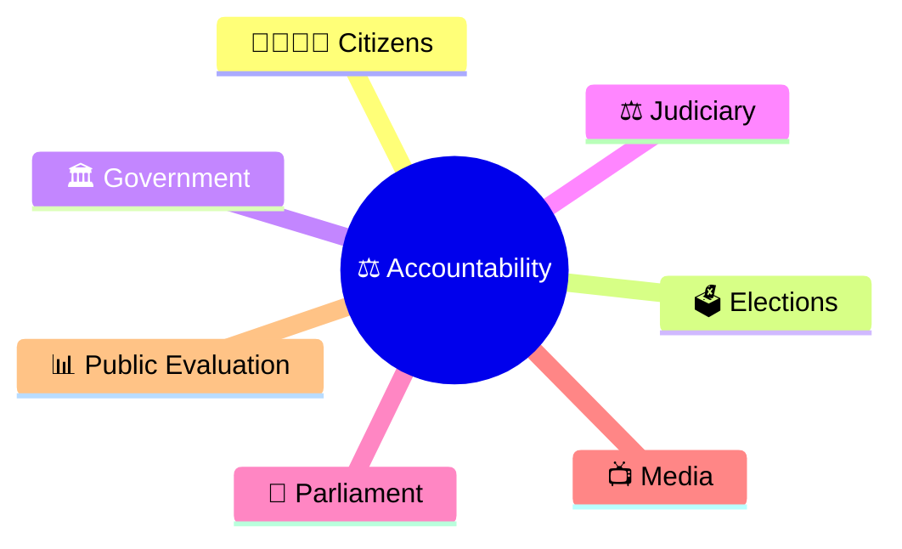
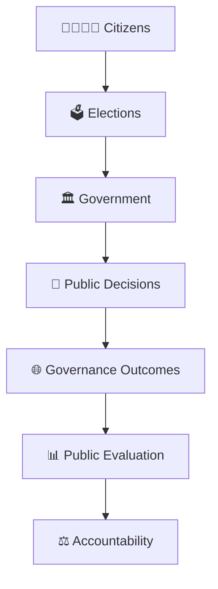
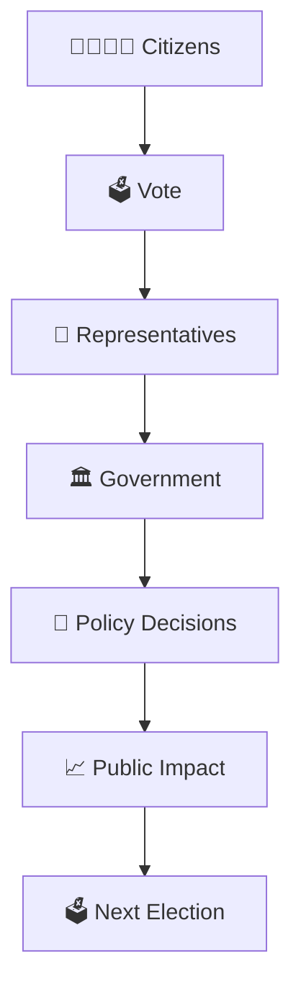
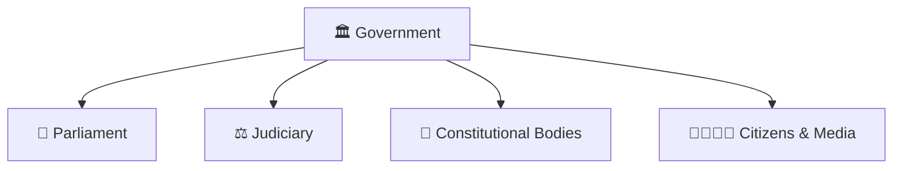
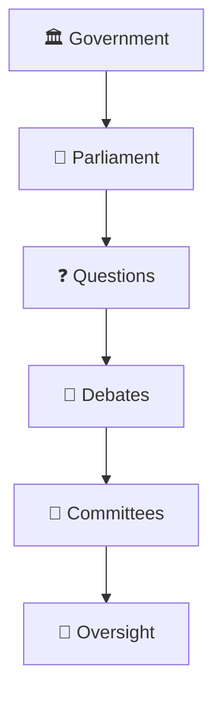
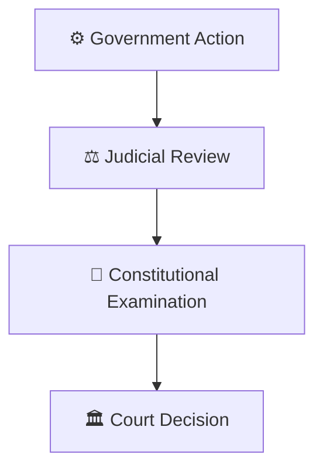
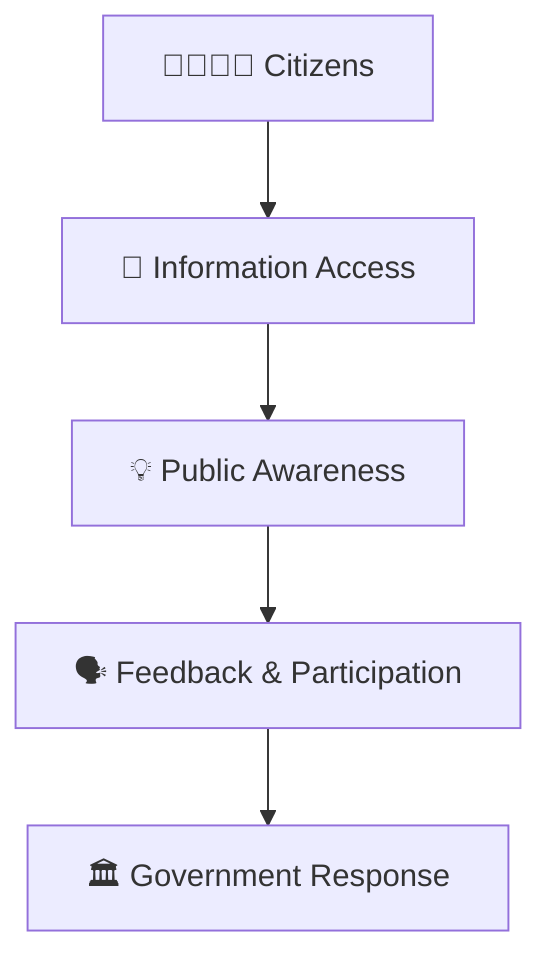
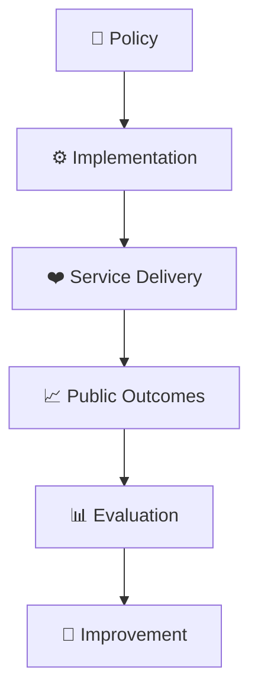

# Accountability Framework

## Overview

This diagram explains how accountability operates within a democratic governance system and how citizens, institutions, and government bodies interact to ensure responsible governance.

It helps visualize the mechanisms that keep public institutions answerable for their actions and decisions.

---

## Why It Matters

Understanding accountability helps explain:

- How governments remain answerable to citizens
- How democratic oversight functions
- How institutions monitor each other
- How misuse of power can be checked
- How public trust is maintained

---

---

## Core Accountability Framework

---

## Democratic Accountability Cycle

---

## Institutional Accountability Framework

### Purpose

- Prevent concentration of power.
- Encourage transparency.
- Improve governance quality.

---

## Parliamentary Accountability

### Examples

- Question Hour
- Parliamentary Committees
- Budget Scrutiny
- Legislative Debates

---

## Judicial Accountability Mechanism

### Purpose

- Ensure constitutional compliance.
- Protect rights and liberties.

---

## Public Accountability Framework

---

## Governance Outcome Loop

---

## Quick Revision

---

## Related Topics

- governance-framework.md
- citizen-to-policy-journey.md
- public-policy-lifecycle.md
- centre-state-relations-framework.md
- governance-terminology.md
- administrative-terminology.md
