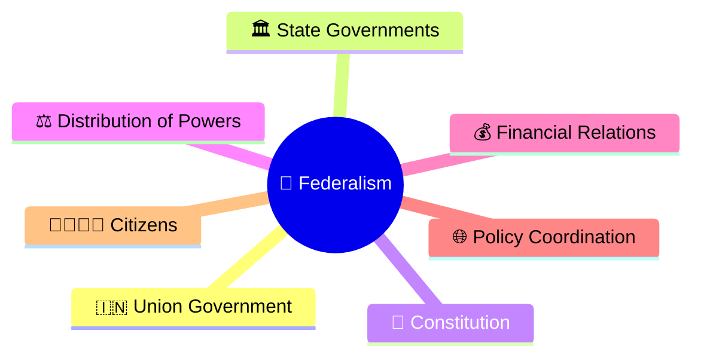
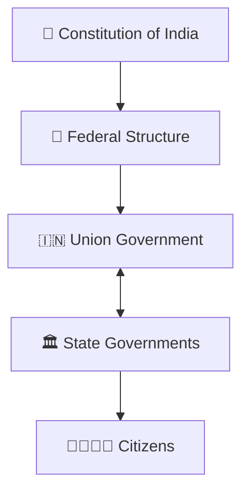
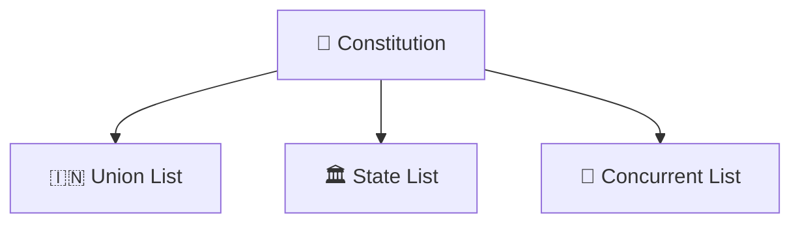
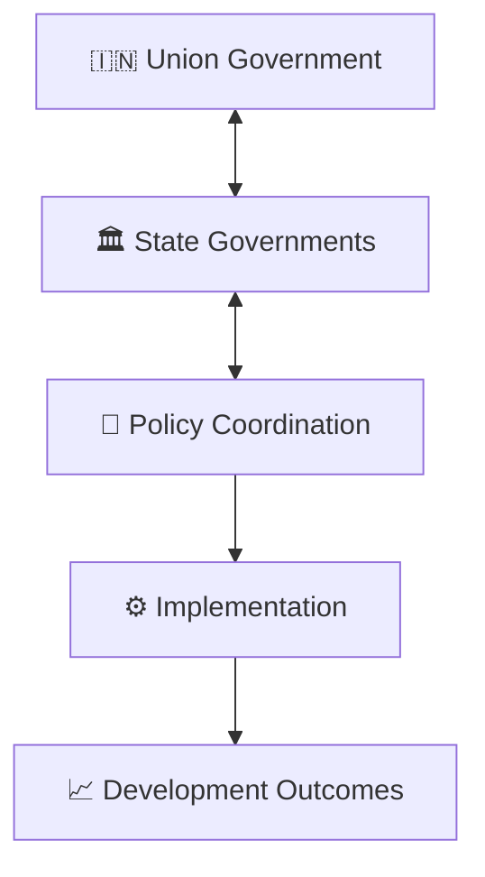
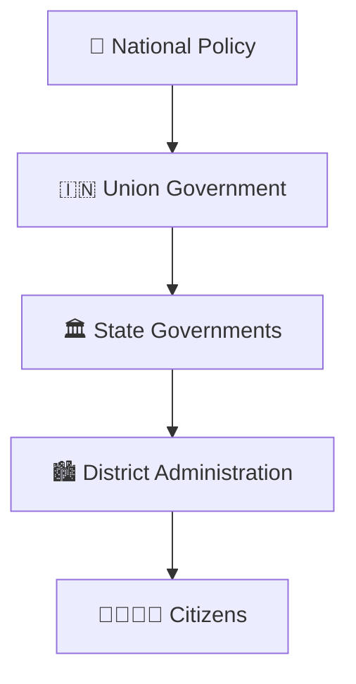
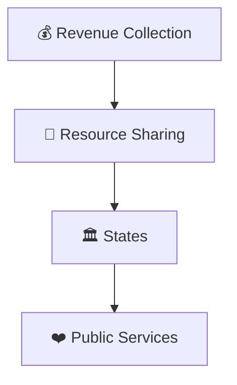
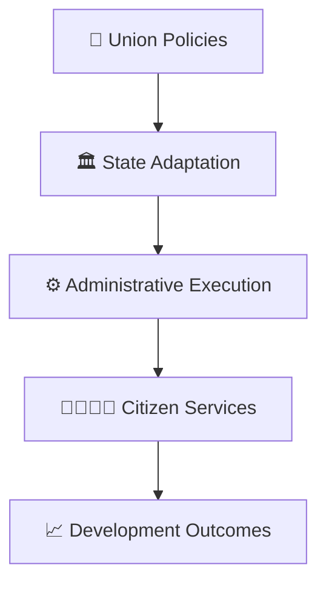

# Centre-State Relations Framework

## Overview

This diagram explains the relationship between the Union Government and State Governments within India's federal system.

It helps visualize how powers, responsibilities, resources, and governance functions are distributed across different levels of government.

---

## Why It Matters

Understanding Centre-State relations helps explain:

- How federalism works in India
- How powers are distributed
- How governments coordinate policy implementation
- How national and state priorities are balanced
- How cooperative governance functions

---

---

## Federal Governance Framework

---

## Distribution of Powers

### Purpose

- Clearly define responsibilities.
- Reduce administrative conflicts.
- Improve governance efficiency.

---

## Cooperative Federalism Model

---

## Policy Implementation Framework

### Outcome

- National priorities reach local communities.
- State-level adaptation improves effectiveness.

---

## Financial Relations Framework

### Purpose

- Support balanced development.
- Strengthen state capacity.
- Improve service delivery.

---

## Governance Coordination Framework

---

## Quick Revision

---

## Related Topics

- governance-framework.md
- accountability-framework.md
- citizen-to-policy-journey.md
- public-policy-lifecycle.md
- contemporary-governance.md
- governance-terminology.md
