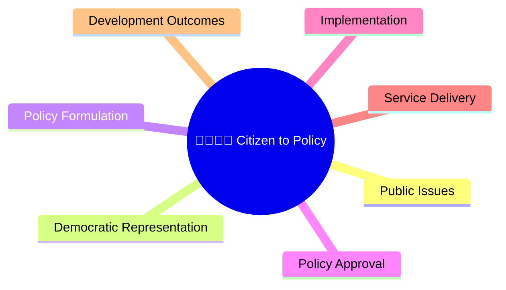
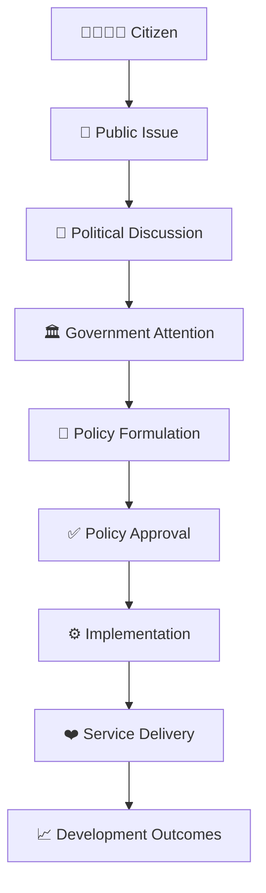
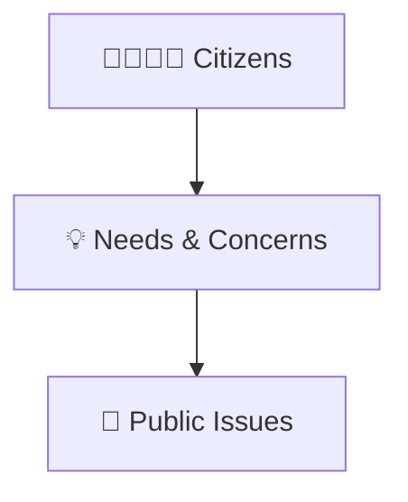
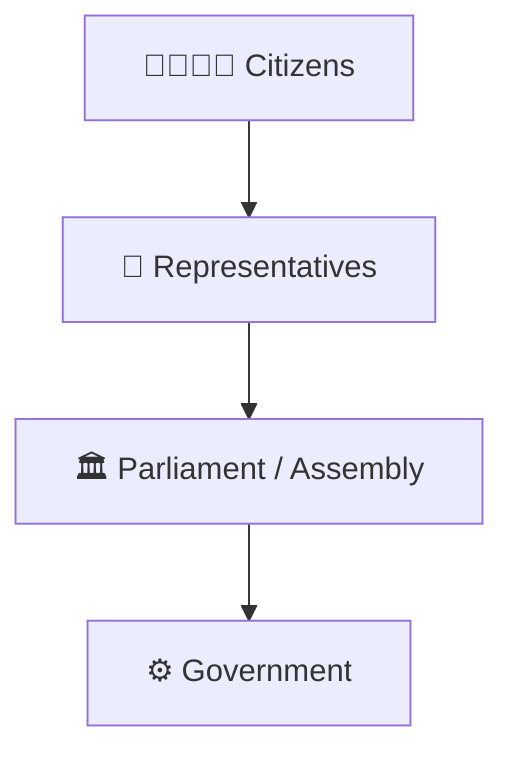
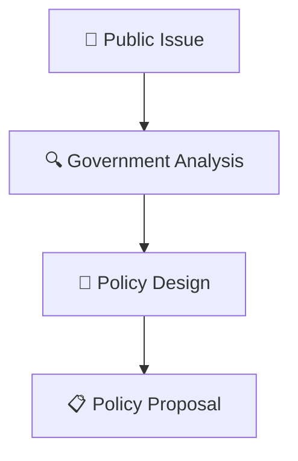
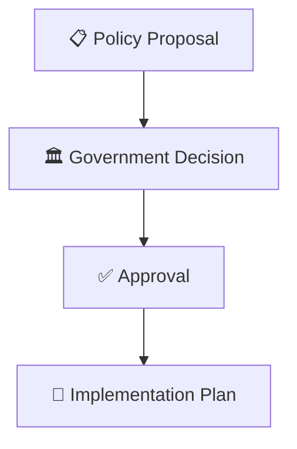
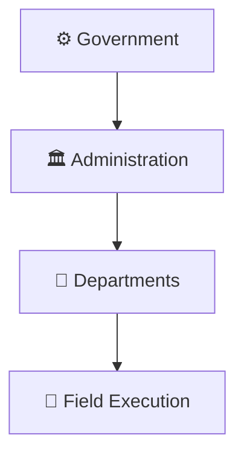
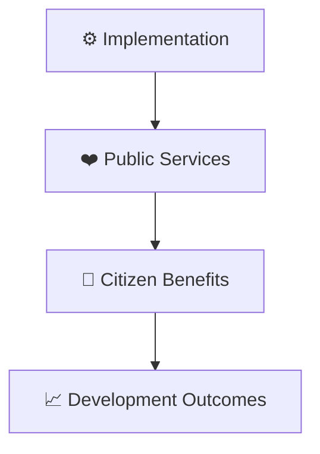
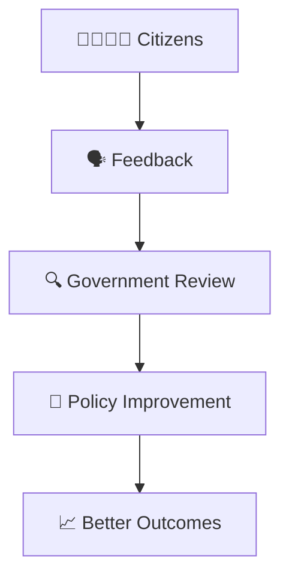
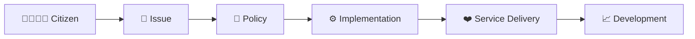

# Citizen to Policy Journey

## Overview

This diagram explains how citizen needs, concerns, and demands are transformed into public policies and government actions.

It helps visualize the connection between citizens, democratic institutions, policy-making, administration, and governance outcomes.

---

## Why It Matters

Understanding the citizen-to-policy journey helps explain:

- How public issues reach government institutions
- How policies are created
- How democratic participation influences governance
- How administration implements decisions
- How governance outcomes affect citizens

---

## Complete Citizen to Policy Journey

---

## Stage 1: Citizen Needs

### Examples

- Education
- Healthcare
- Employment
- Infrastructure
- Public Safety

---

## Stage 2: Democratic Representation

### Outcome

- Public concerns enter democratic institutions.
- Issues gain policy attention.

---

## Stage 3: Policy Formulation

### Outcome

- Solutions are evaluated.
- Policy options are developed.

---

## Stage 4: Policy Approval

---

## Stage 5: Implementation

### Outcome

- Policies move from planning to action.

---

## Stage 6: Citizen Outcomes

---

## Feedback Loop

---

## Quick Revision

---

## Related Topics

- governance-framework.md
- public-policy-lifecycle.md
- accountability-framework.md
- centre-state-relations-framework.md
- contemporary-public-policy.md
- governance-terminology.md
