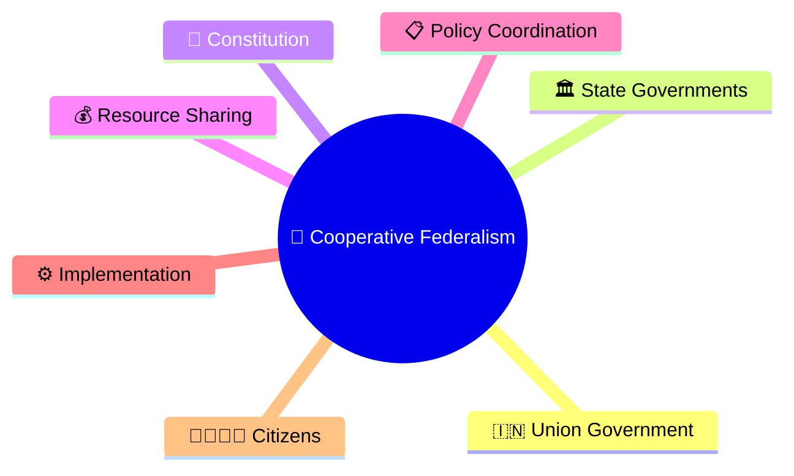
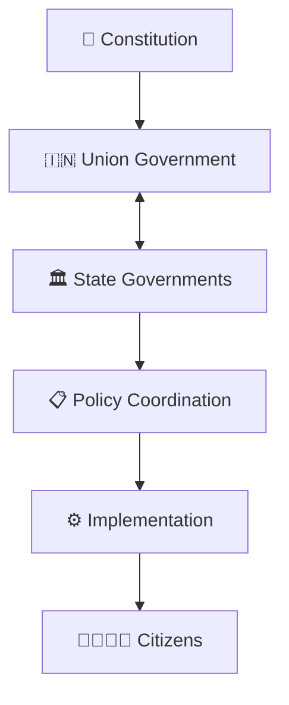
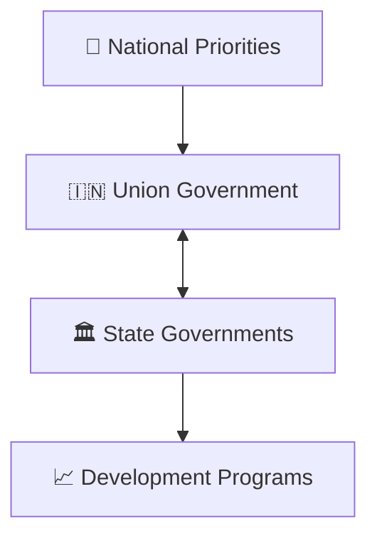
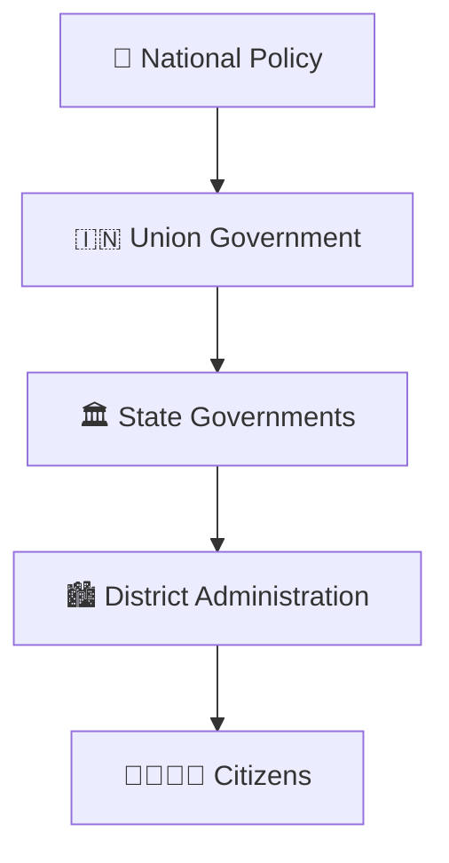
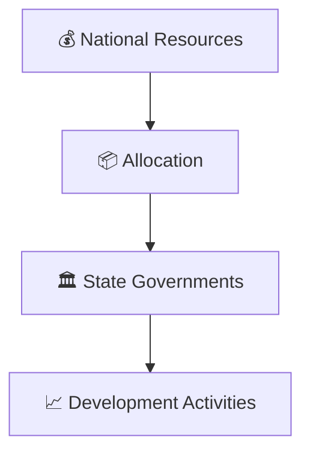
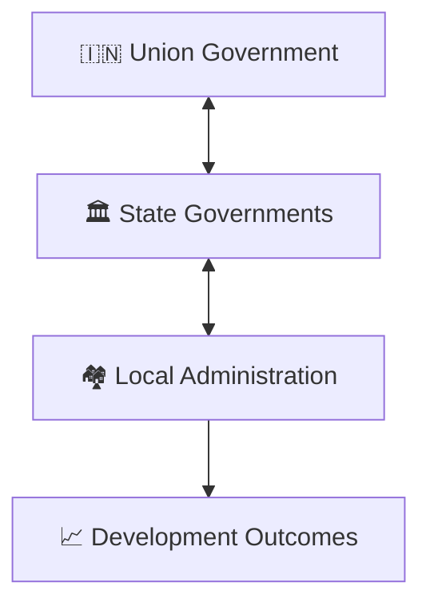
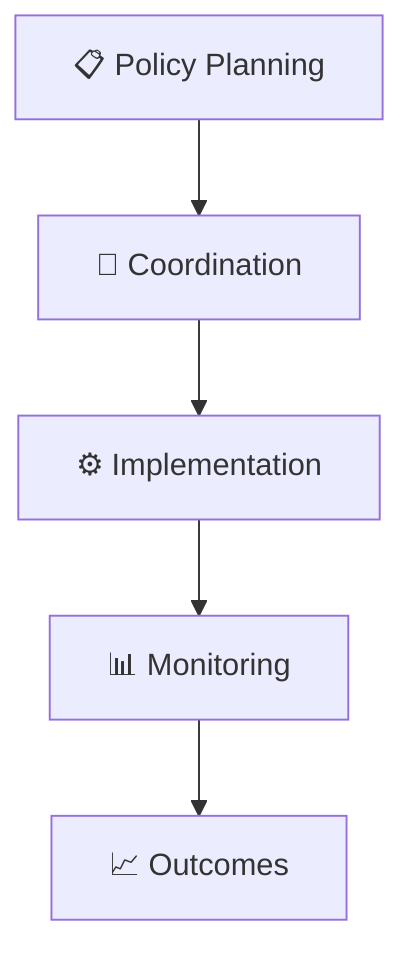

# Cooperative Federalism Model

## Overview

This diagram explains how the Union Government and State Governments work together within India's federal system to achieve governance, development, and public service delivery goals.

It helps visualize coordination, resource sharing, policy implementation, and joint decision-making across different levels of government.

---

## Why It Matters

Understanding cooperative federalism helps explain:

- How India's federal structure functions
- How national and state priorities are aligned
- How policies are implemented across the country
- How development programs are coordinated
- How governance outcomes are improved

---

---

## Cooperative Federalism Framework

---

## Shared Governance Model

### Purpose

- Align governance goals
- Improve coordination
- Strengthen implementation

---

## Policy Implementation Framework

### Outcome

- Consistent policy execution
- Local adaptation of programs
- Improved service delivery

---

## Resource Sharing Framework

### Purpose

- Balanced development
- Administrative support
- Effective implementation

---

## Development Partnership Model

---

## Governance Coordination Flow

---

## Quick Revision

---

## Related Topics

- governance-framework.md
- centre-state-relations-framework.md
- administrative-hierarchy.md
- public-service-delivery-workflow.md
- digital-governance-framework.md
- governance-terminology.md
