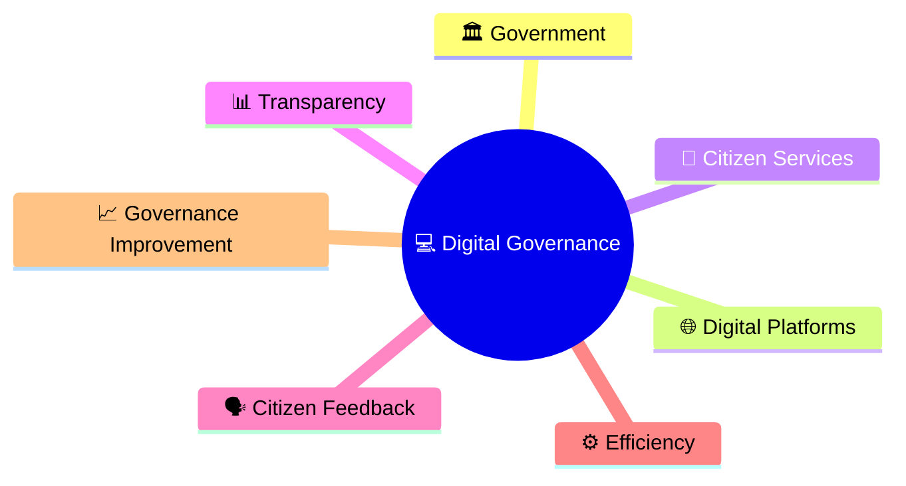
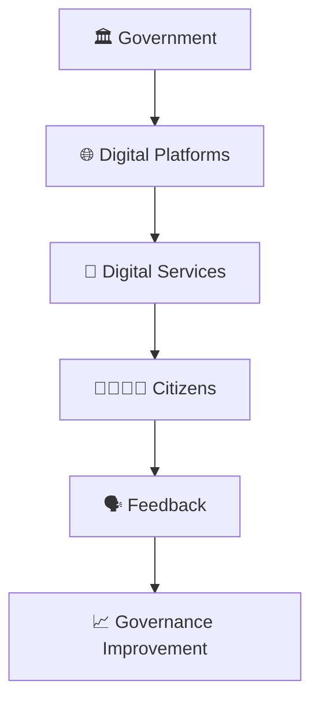
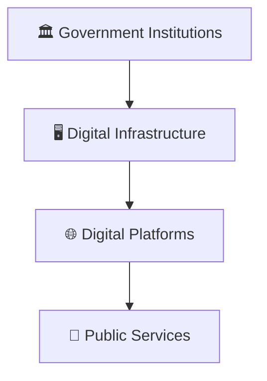
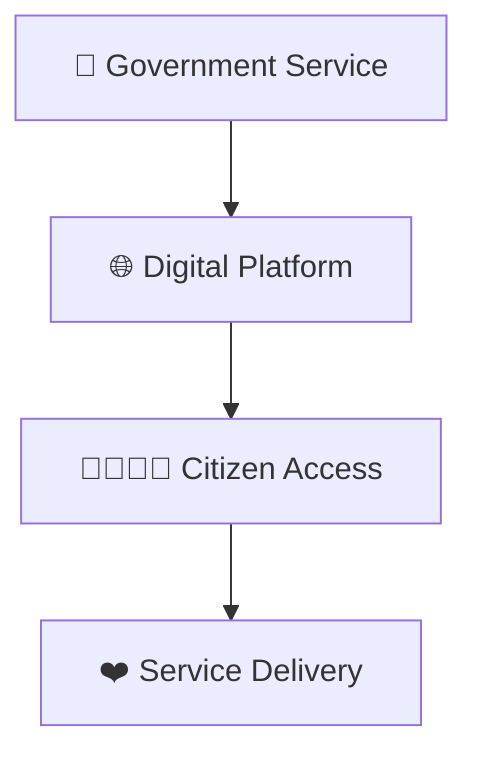
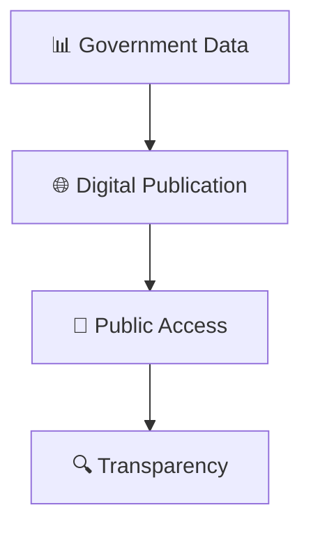
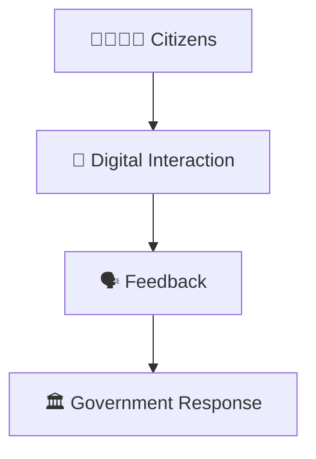
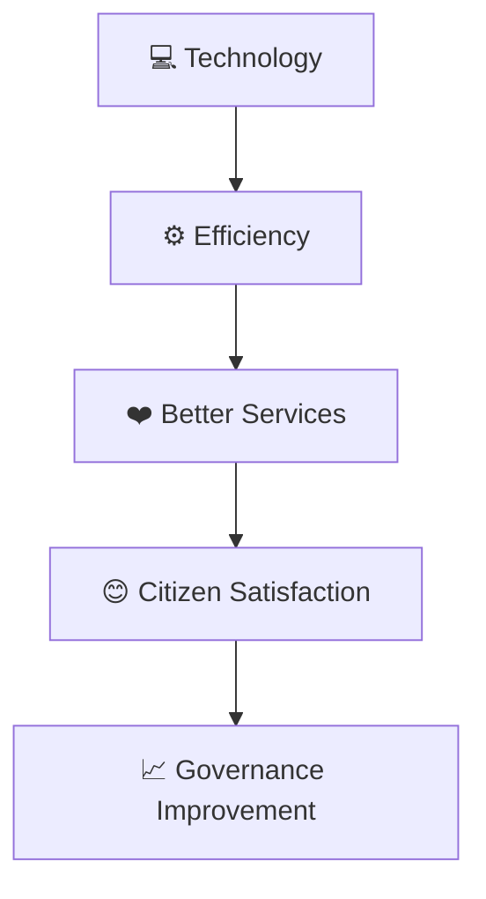
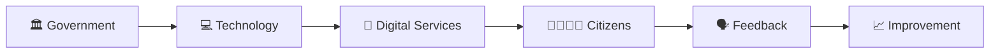

# Digital Governance Framework

## Overview

This diagram explains how digital technologies are used to improve governance, public administration, service delivery, transparency, accountability, and citizen participation.

It helps visualize the transformation of traditional governance into technology-enabled governance.

---

## Why It Matters

Understanding digital governance helps explain:

- How technology improves governance
- How services become more accessible
- How administrative efficiency increases
- How transparency and accountability improve
- How citizens interact digitally with government

---

---

## Digital Governance Framework

---

## Digital Governance Ecosystem

### Purpose

- Improve accessibility
- Increase efficiency
- Strengthen governance outcomes

---

## Service Delivery Model

### Outcome

- Faster access to services
- Reduced administrative friction
- Improved citizen experience

---

## Transparency Framework

### Purpose

- Increase public visibility
- Improve accountability
- Build trust in institutions

---

## Citizen Participation Model

### Outcome

- Greater citizen engagement
- Improved responsiveness
- Better governance decisions

---

## Governance Improvement Cycle

---

## Quick Revision

---

## Related Topics

- governance-framework.md
- e-governance-workflow.md
- public-service-delivery-workflow.md
- administrative-hierarchy.md
- cooperative-federalism-model.md
- governance-terminology.md
