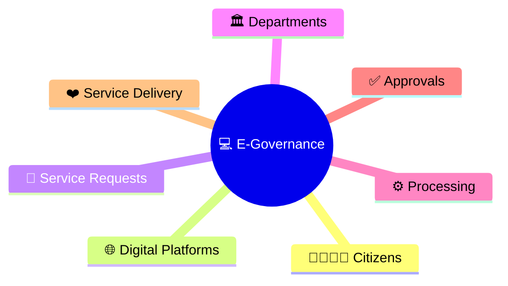
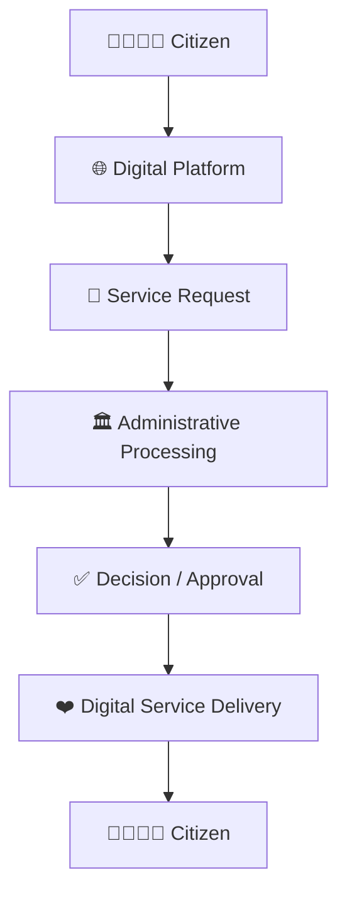
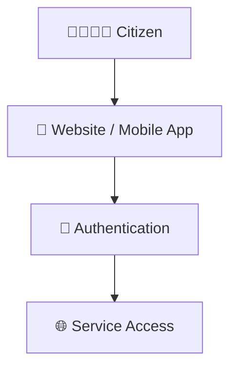
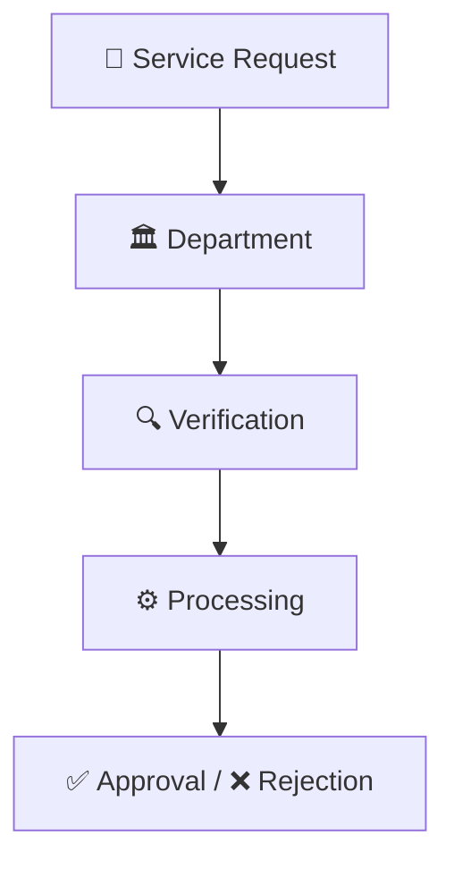
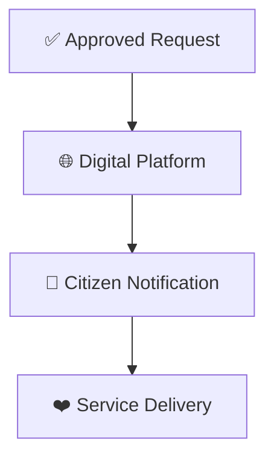
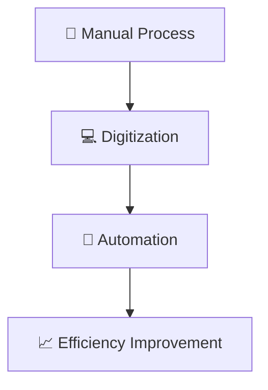
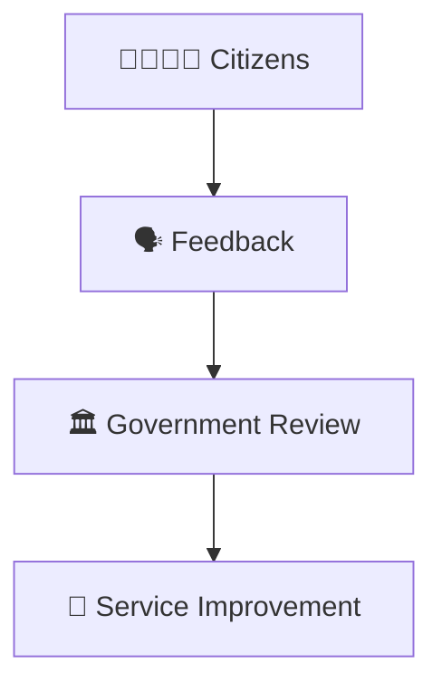
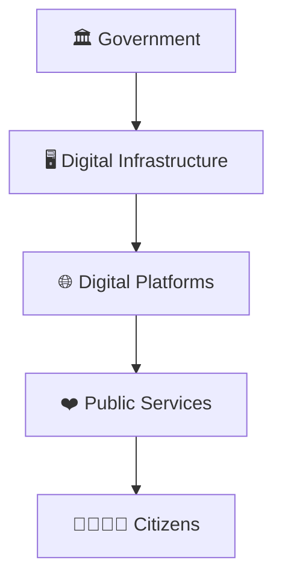
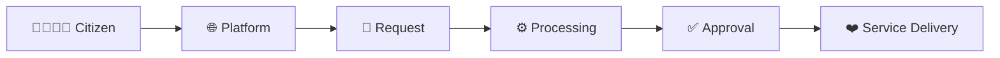

# E-Governance Workflow

## Overview

This diagram explains how electronic governance (e-governance) enables governments to deliver services, process requests, manage information, and interact with citizens using digital technologies.

It helps visualize the end-to-end workflow from citizen requests to digital service delivery.

---

## Why It Matters

Understanding e-governance helps explain:

- How government services are digitized
- How citizens access services online
- How administrative processes become efficient
- How transparency improves
- How governance becomes more accessible

---

---

## E-Governance Workflow

---

## Citizen Access Model

### Purpose

- Simplify access
- Reduce physical visits
- Improve convenience

---

## Service Processing Workflow

### Outcome

- Faster processing
- Standardized workflows
- Better tracking

---

## Digital Service Delivery Model

### Outcome

- Faster service delivery
- Improved transparency
- Better citizen experience

---

## Administrative Efficiency Framework

---

## Feedback & Improvement Cycle

### Purpose

- Improve quality
- Increase responsiveness
- Enhance governance outcomes

---

## E-Governance Ecosystem

---

## Quick Revision

---

## Related Topics

- digital-governance-framework.md
- public-service-delivery-workflow.md
- administrative-hierarchy.md
- governance-framework.md
- cooperative-federalism-model.md
- governance-terminology.md
