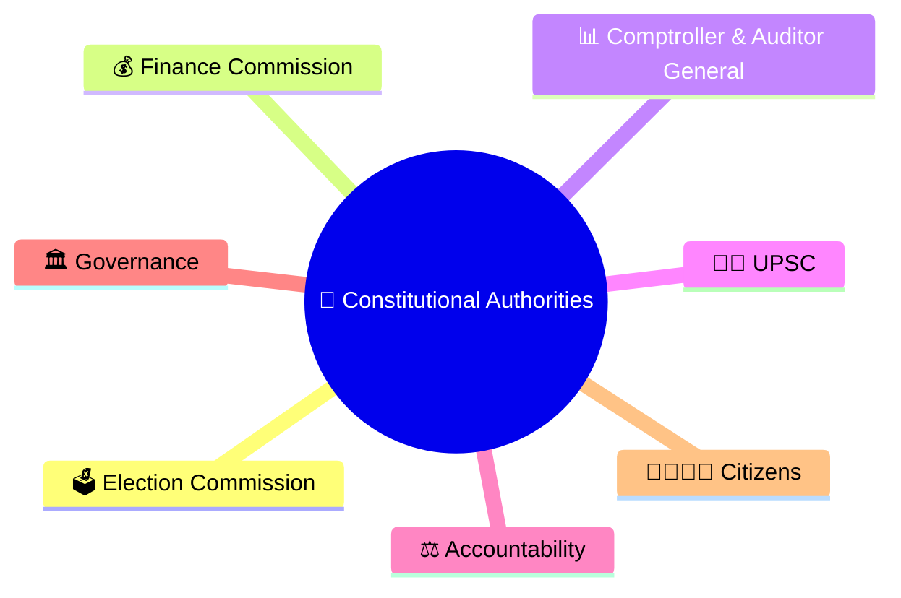
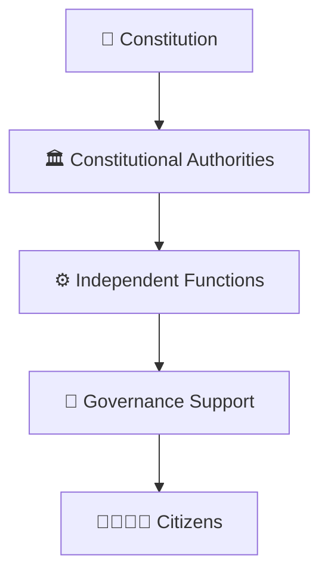
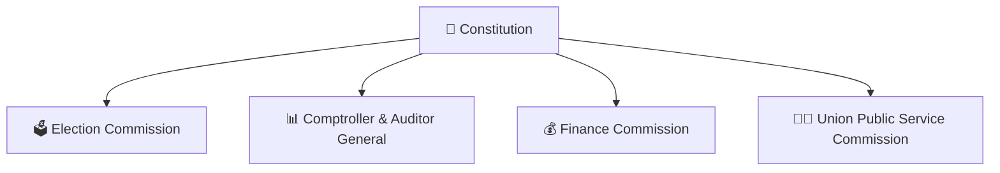
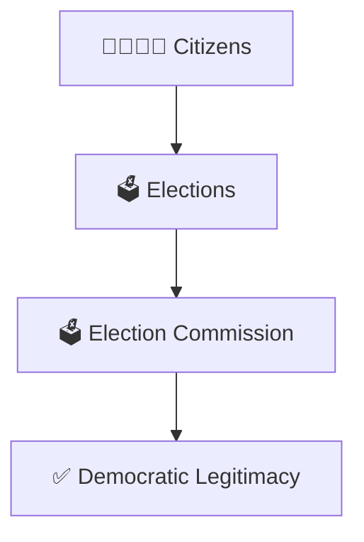
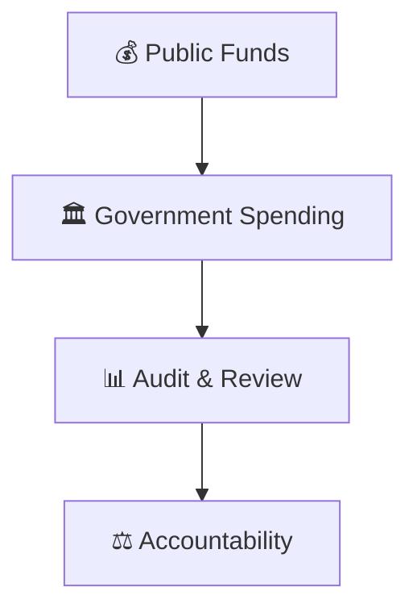
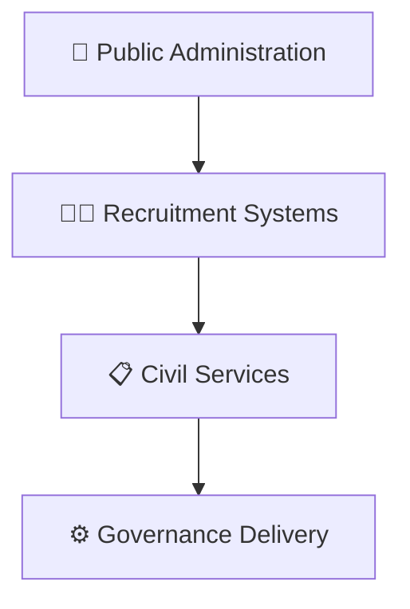
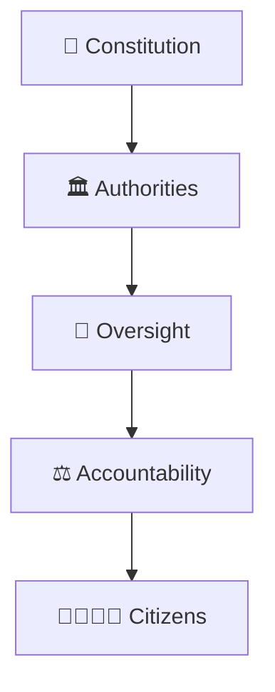

# Constitutional Authorities Framework

## Overview

This diagram explains the major constitutional authorities established by the Constitution of India and their role in maintaining democratic governance, accountability, elections, financial oversight, and constitutional stability.

It helps visualize how independent constitutional bodies support the functioning of the Republic.

---

## Why It Matters

Understanding constitutional authorities helps explain:

- How democratic institutions are protected
- How elections remain credible
- How public finances are audited
- How constitutional accountability is maintained
- How governance remains independent and transparent

---

## Constitutional Authorities Framework

---

## Institutional Structure

### Purpose

- Strengthen institutions
- Ensure accountability
- Support democratic governance

---

## Electoral Governance Framework

### Significance

- Conducts elections
- Protects electoral integrity
- Supports representative democracy

---

## Financial Accountability Framework

### Significance

- Financial oversight
- Public accountability
- Responsible governance

---

## Administrative Governance Framework

### Significance

- Merit-based administration
- Institutional continuity
- Administrative efficiency

---

## Constitutional Balance Model

### Purpose

- Prevent concentration of power
- Improve transparency
- Strengthen democratic institutions

---

## Quick Revision

---

## Related Topics

- constitutional-governance-model.md
- parliament-structure.md
- election-commission-structure.md
- accountability-framework.md
- judicial-review-framework.md
- constitutional-development-timeline.md
