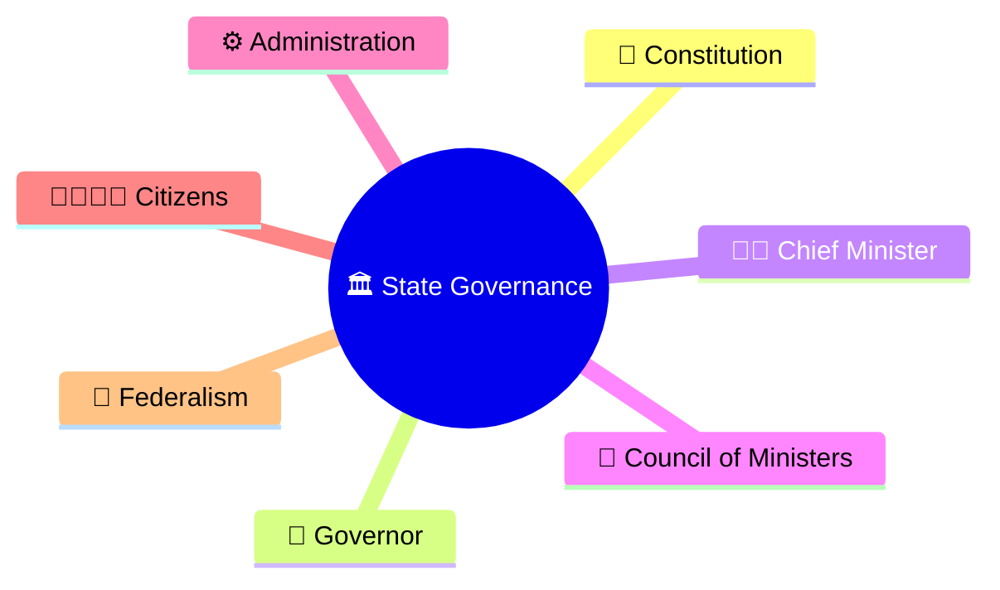
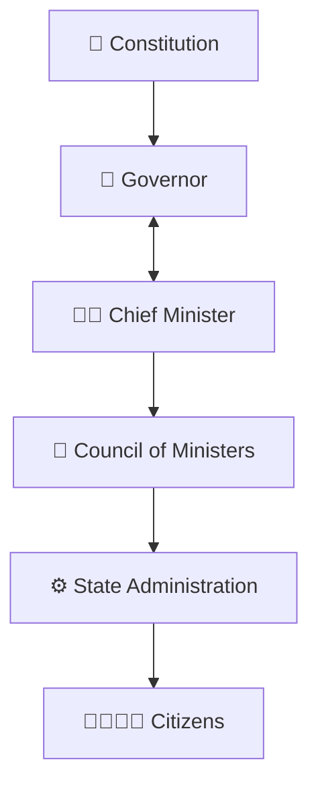
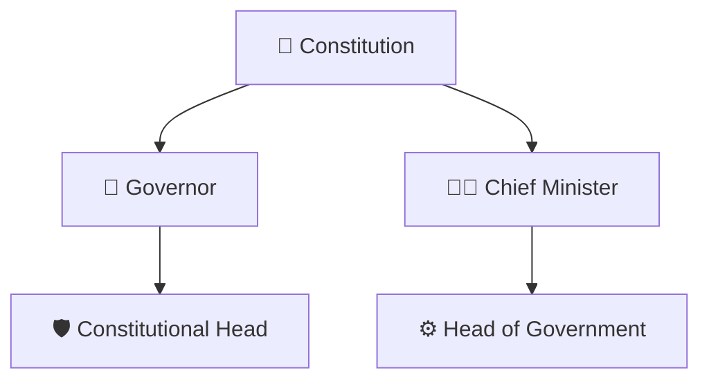
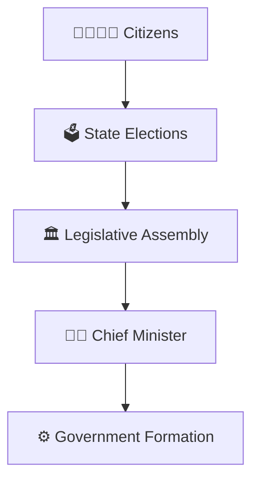
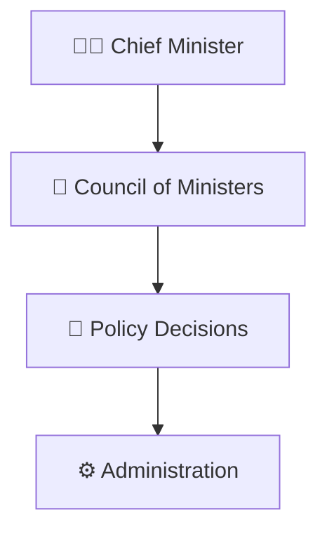
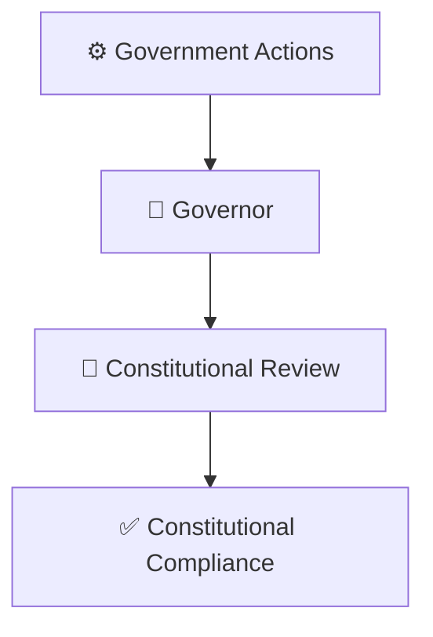
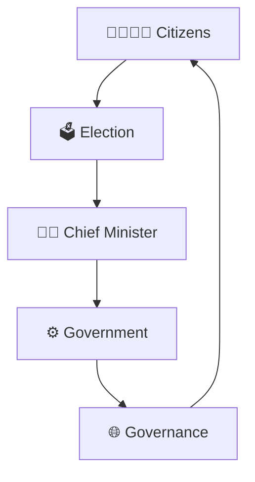
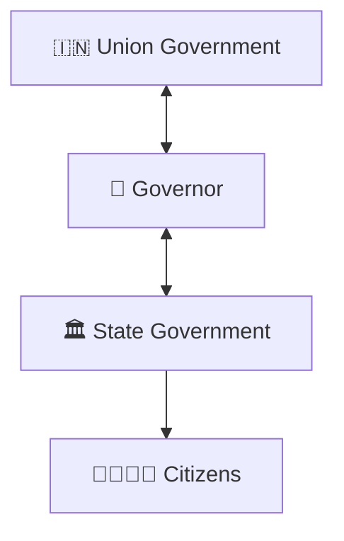
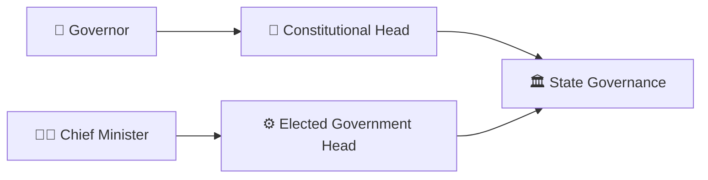

# Governor–Chief Minister Relationship

## Overview

This diagram explains the constitutional relationship between the Governor and the Chief Minister within a State Government.

It helps visualize how constitutional authority, democratic representation, executive governance, and accountability operate at the state level.

---

## Why It Matters

Understanding the Governor–Chief Minister relationship helps explain:

- How state governments function
- How constitutional and elected authorities interact
- How executive decisions are implemented
- How constitutional stability is maintained
- How federal governance operates in India

---

## Governor–Chief Minister Framework

---

## Constitutional Structure

### Significance

- Governor is the constitutional head of the state
- Chief Minister leads the elected government
- Both operate within constitutional limits

---

## Democratic Governance Model

### Purpose

- Democratic representation
- Electoral legitimacy
- Responsible government

---

## Executive Governance Framework

### Significance

- Day-to-day governance
- Policy implementation
- Administrative leadership

---

## Constitutional Accountability Model

### Purpose

- Preserve constitutional order
- Ensure lawful governance
- Maintain institutional balance

---

## State Governance Cycle

---

## Federal Governance Connection

### Significance

- Supports federal coordination
- Connects constitutional institutions
- Maintains governance continuity

---

## Quick Revision

---

## Related Topics

- president-prime-minister-relationship.md
- state-government-structure.md
- union-government-structure.md
- constitutional-authorities-framework.md
- centre-state-relations-framework.md
- constitutional-governance-model.md
