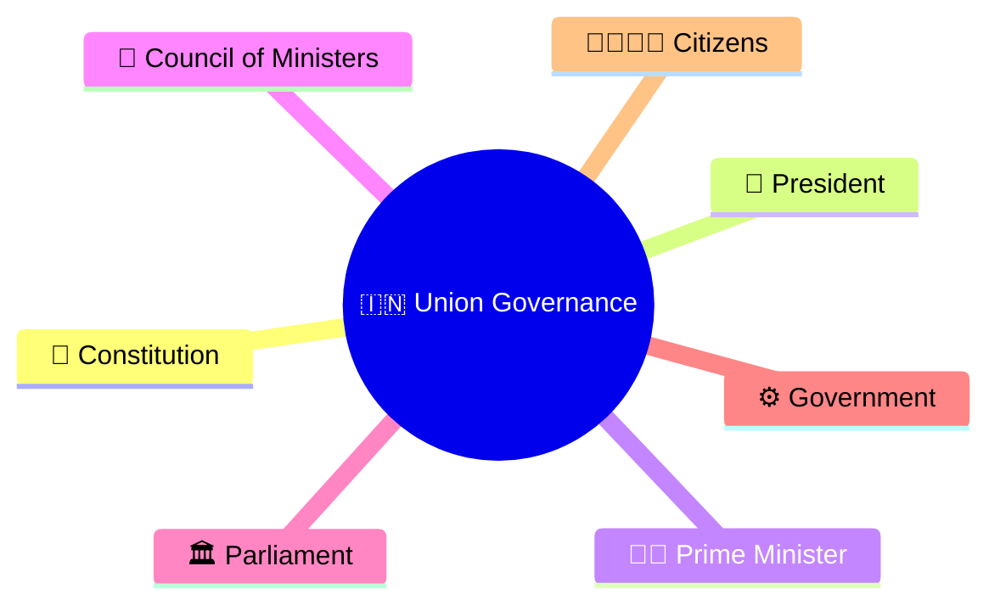
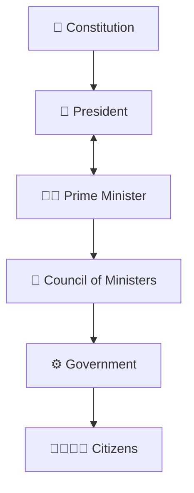
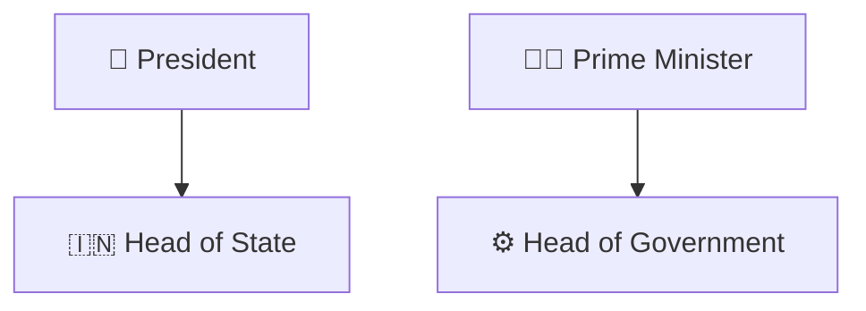
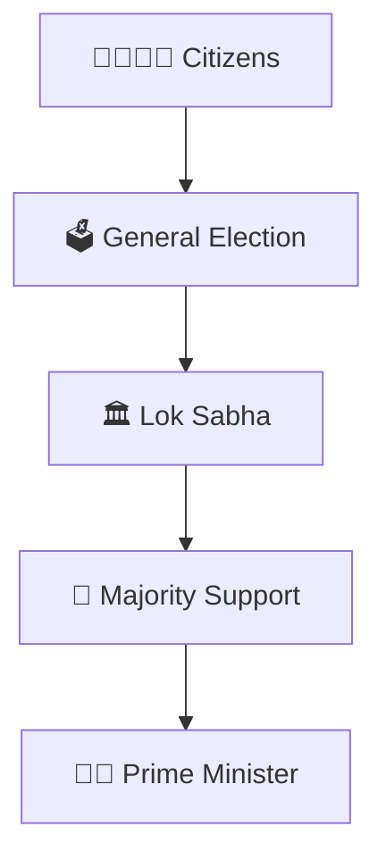
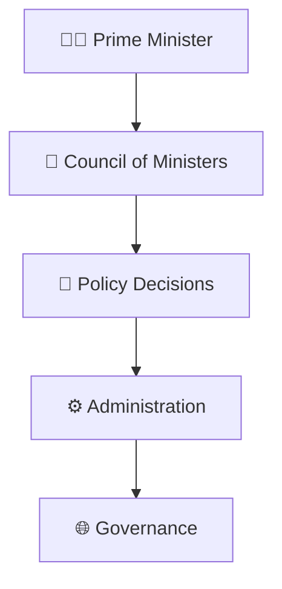
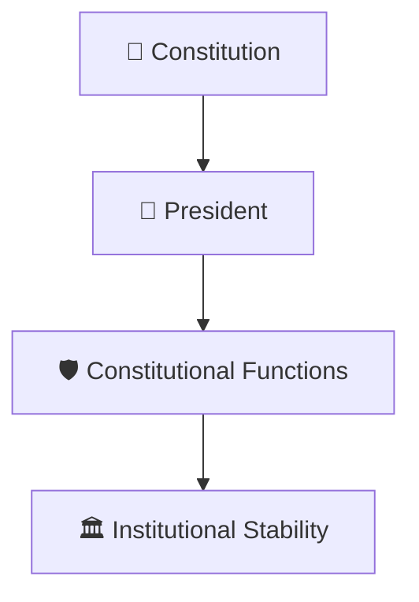
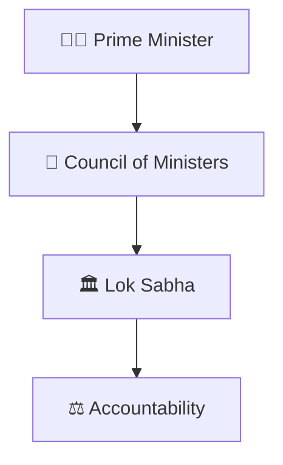
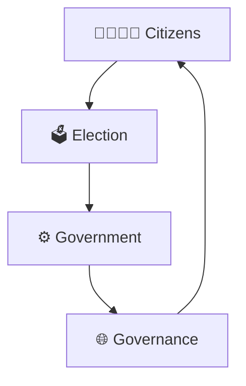
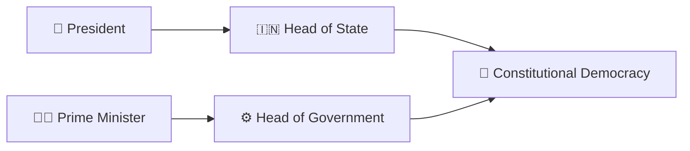

# President–Prime Minister Relationship

## Overview

This diagram explains the constitutional relationship between the President of India and the Prime Minister.

It helps visualize the distinction between the Head of State and the Head of Government, and how constitutional authority and executive governance operate within India's parliamentary democracy.

---

## Why It Matters

Understanding the President–Prime Minister relationship helps explain:

- Who governs India on a day-to-day basis
- The difference between constitutional authority and executive authority
- How parliamentary democracy functions
- How constitutional checks and balances operate
- How governments are formed and sustained

---

---

## President–Prime Minister Framework

---

## Constitutional Structure

### Significance

- President represents the Republic
- Prime Minister leads the elected government
- Both function within constitutional limits

---

## Democratic Governance Model

### Purpose

- Democratic legitimacy
- Representative governance
- Responsible government

---

## Executive Governance Framework

### Significance

- Leads executive governance
- Coordinates government policy
- Oversees administration

---

## Constitutional Authority Framework

### Purpose

- Preserve constitutional continuity
- Protect democratic processes
- Ensure lawful governance

---

## Parliamentary Accountability Model

### Significance

- Responsible government
- Legislative oversight
- Democratic accountability

---

## Governance Cycle

---

## Quick Revision

---

## Related Topics

- governor-chief-minister-relationship.md
- union-government-structure.md
- state-government-structure.md
- constitutional-authorities-framework.md
- parliament-structure.md
- constitutional-governance-model.md
