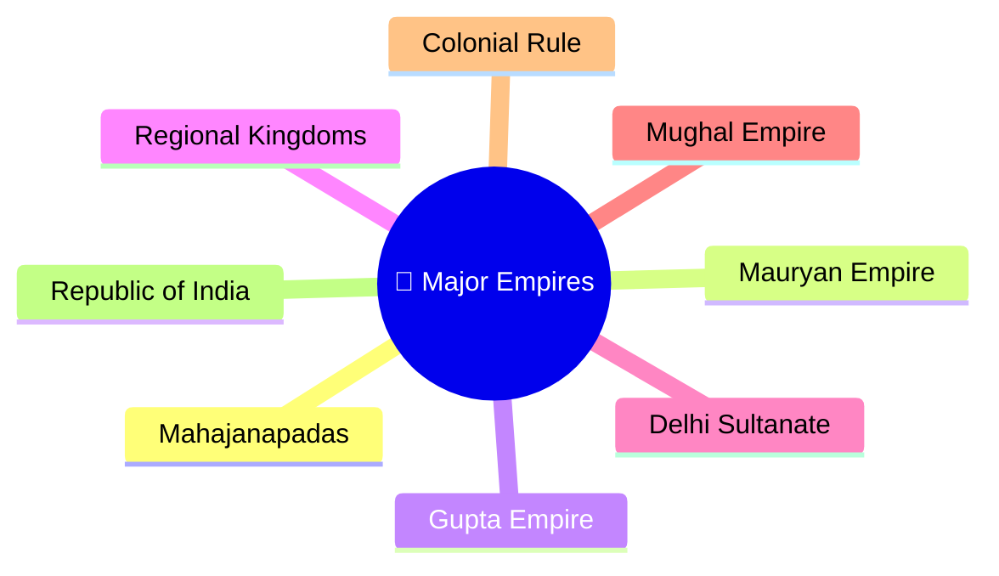
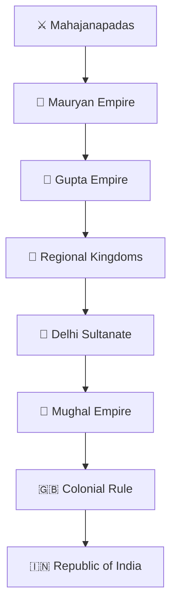
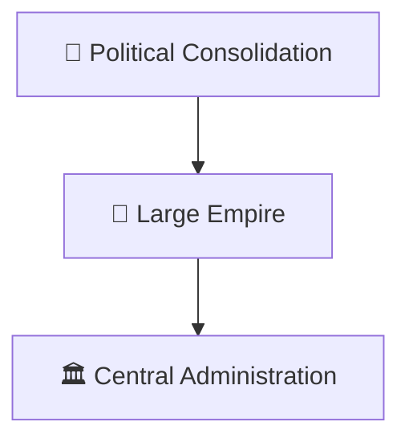
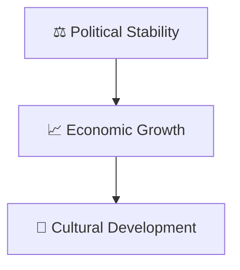
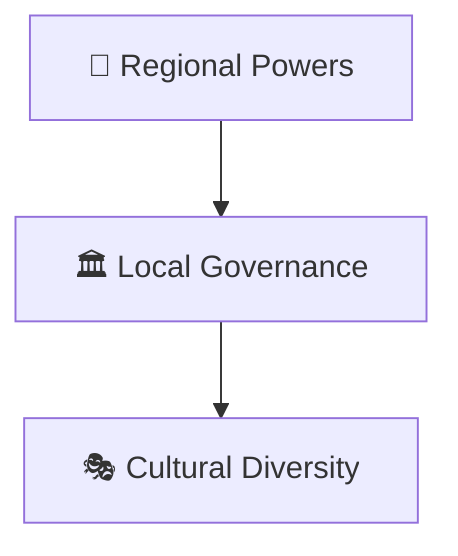
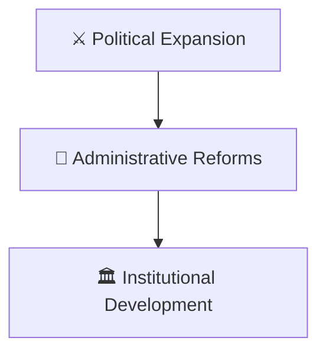
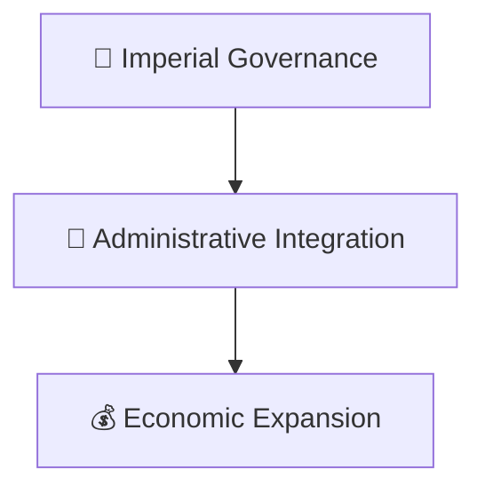
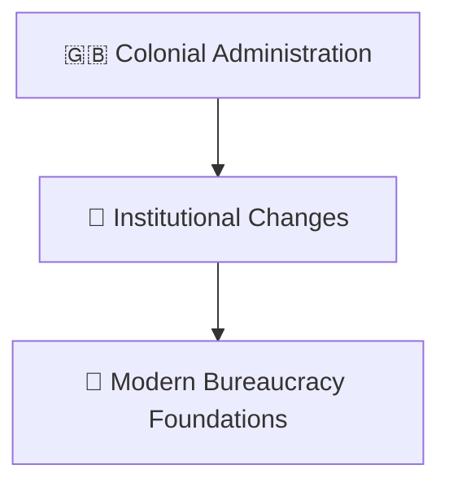
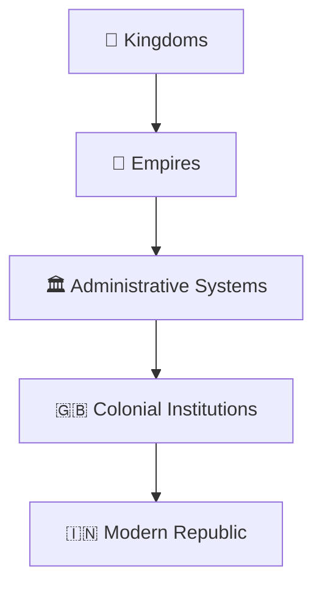

# Major Empires Timeline

## Overview

This diagram explains the major empires that shaped India's political, administrative, economic, and cultural development across different historical periods.

It provides a high-level timeline for understanding the evolution of governance and state formation in India.

---

## Why It Matters

Understanding major empires helps explain:

- Evolution of political systems
- Development of administration
- Expansion of trade networks
- Cultural integration and exchange
- Foundations of modern governance

---

## Major Empires Timeline

---

## Mauryan Empire

### Significance

- Large-scale political unification
- Administrative organization
- Expansion of governance structures

---

## Gupta Empire

### Significance

- Scientific advancement
- Cultural achievements
- Administrative continuity

---

## Regional Kingdoms

### Significance

- Regional political development
- Diverse governance models

---

## Delhi Sultanate

### Significance

- New administrative systems
- Expansion of state structures

---

## Mughal Empire

### Significance

- Large-scale administration
- Revenue reforms
- Political integration

---

## Colonial Rule

### Significance

- Administrative restructuring
- Legal and institutional changes

---

## Governance Evolution

---

## Quick Revision

---

## Related Topics

- india-through-time-timeline.md
- ancient-to-contemporary-india-journey.md
- freedom-struggle-timeline.md
- nation-building-timeline.md
- civilization-and-history.md
- constitution-and-nation-building.md
