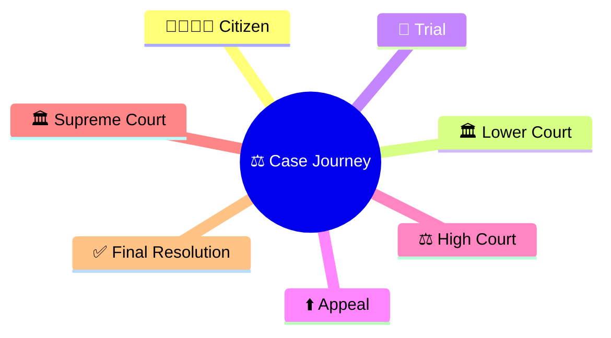
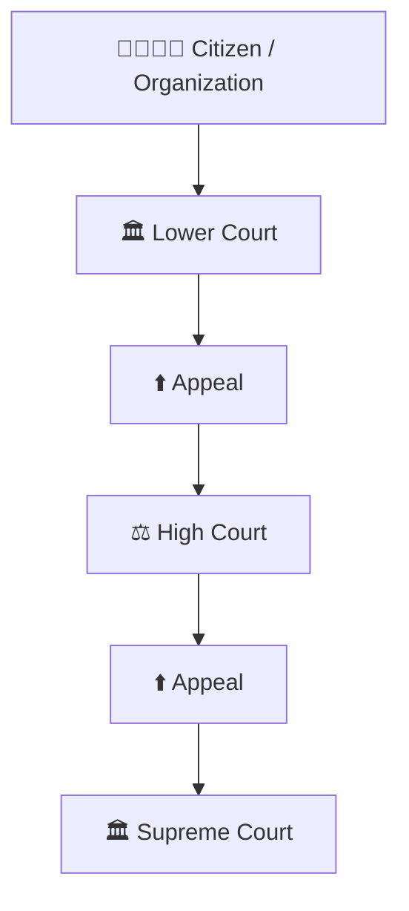
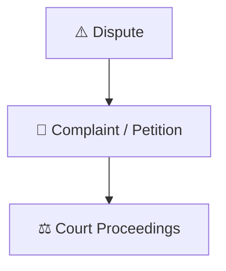
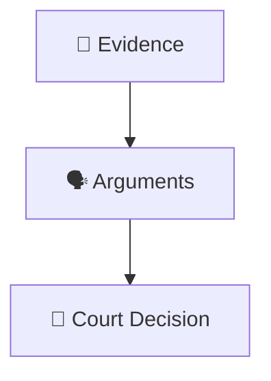
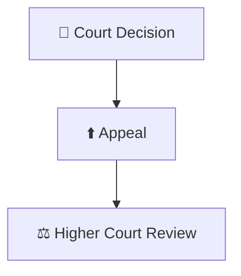
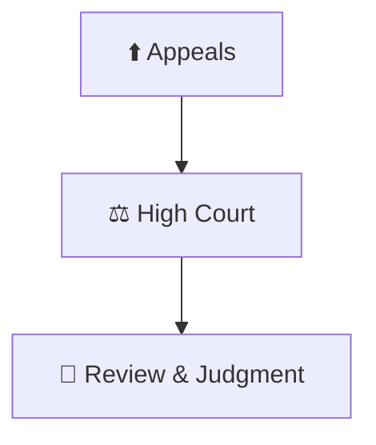
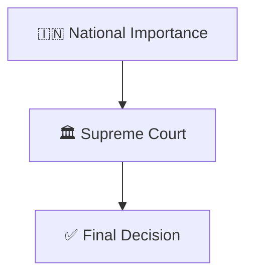
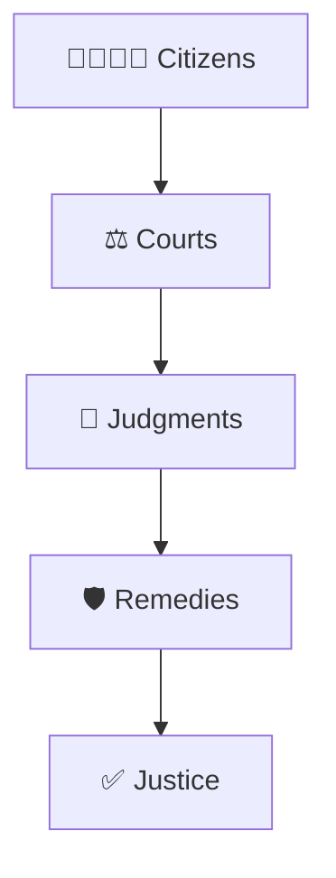
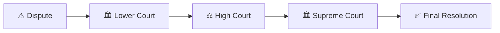

# Case Journey Through Courts

## Overview

This diagram explains how a legal case can move through the Indian judicial system from lower courts to the highest court in the country.

It helps visualize the structure of appeals, judicial review, and the process through which disputes are resolved.

---

## Why It Matters

Understanding the journey of a case helps explain:

- How justice is delivered
- How appeals work
- How judicial review functions
- How legal disputes are resolved
- How citizens can seek remedies

---

---

## Case Journey Through Courts

---

## Entry into the Judicial System

### Purpose

- Resolve disputes
- Enforce legal rights
- Maintain rule of law

---

## Trial Stage

### Significance

- Fact finding
- Legal examination
- Initial judgment

---

## Appeals Framework

### Purpose

- Correct legal errors
- Ensure fairness
- Improve consistency of justice

---

## High Court Role

### Significance

- Supervises lower courts
- Interprets law
- Protects constitutional rights

---

## Supreme Court Role

### Significance

- Highest court in India
- Final appellate authority
- Constitutional guardian

---

## Justice Delivery Framework

---

## Quick Revision

---

## Related Topics

- judicial-hierarchy.md
- judicial-review-framework.md
- public-interest-litigation-workflow.md
- fundamental-rights-framework.md
- constitutional-governance-model.md
- basic-structure-doctrine.md
