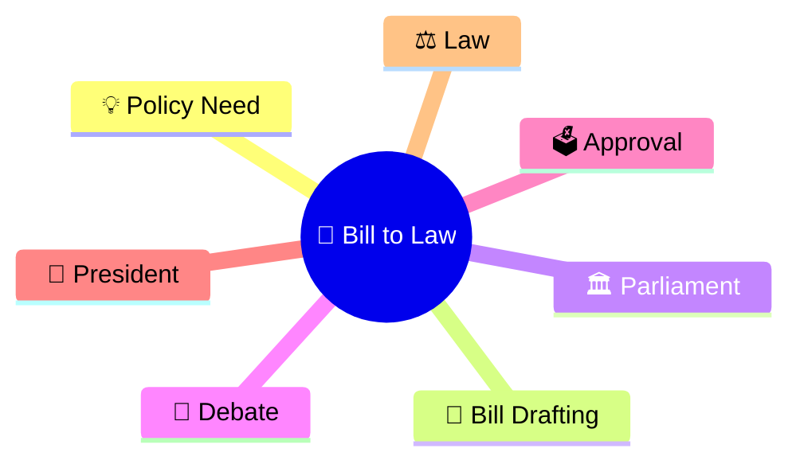
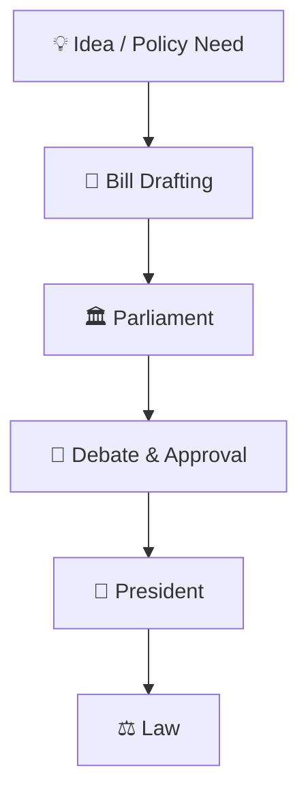
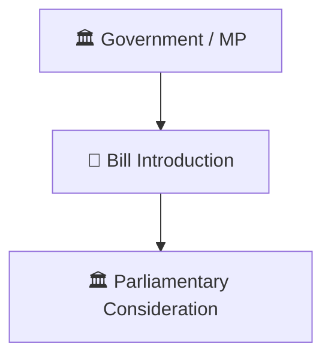
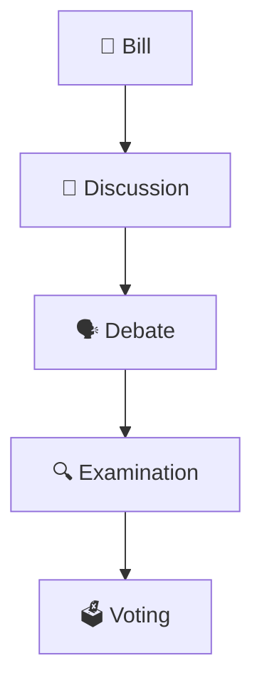
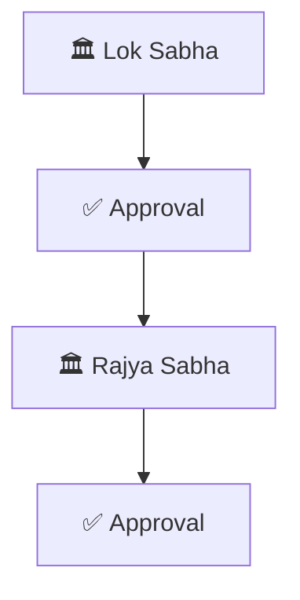
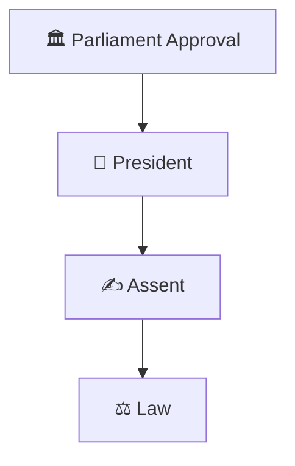
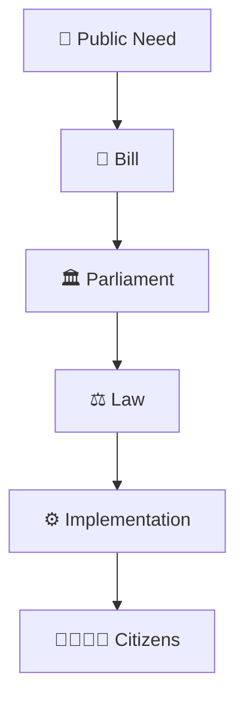
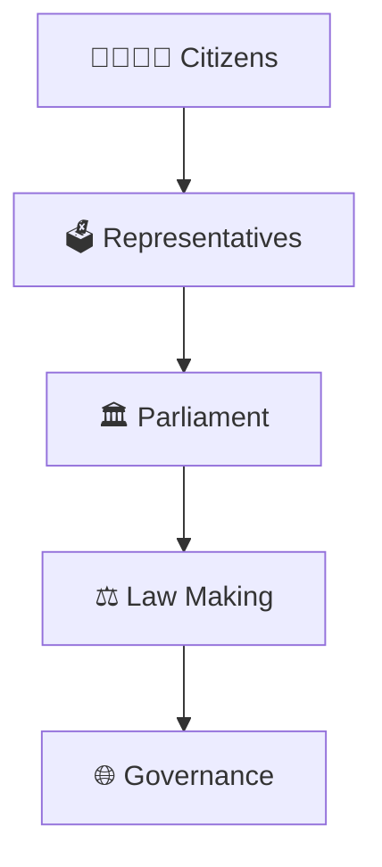
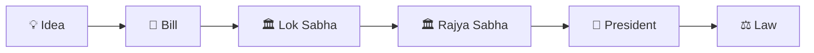

# How a Bill Becomes a Law

## Overview

This diagram explains how a proposed law moves through Parliament and eventually becomes law in India.

It helps visualize the relationship between legislation, parliamentary debate, approval processes, and constitutional authority.

---

## Why It Matters

Understanding how a bill becomes a law helps explain:

- How laws are created
- How Parliament functions
- How elected representatives shape policy
- How democratic scrutiny works
- How governance is influenced through legislation

---

---

## Bill to Law Framework

---

## Legislative Process

### Purpose

- Address public issues
- Create legal frameworks
- Support governance objectives

---

## Parliamentary Review Framework

### Significance

- Democratic scrutiny
- Representative participation
- Legislative accountability

---

## Bicameral Process Model

### Purpose

- Legislative review
- Institutional checks
- Better law making

---

## Presidential Assent Framework

### Significance

- Constitutional completion
- Formal enactment
- Legal validity

---

## Law Making Cycle

---

## Democratic Governance Framework

---

## Quick Revision

---

## Related Topics

- parliament-structure.md
- lok-sabha-vs-rajya-sabha.md
- parliament-session-workflow.md
- parliamentary-committee-system.md
- constitutional-governance-model.md
- major-laws-timeline.md
