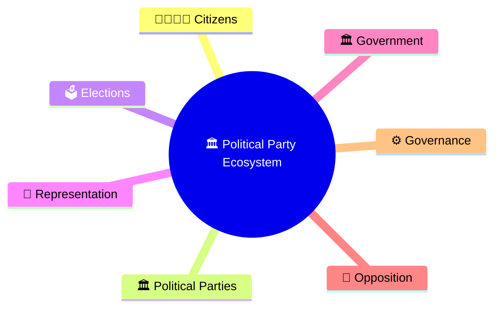
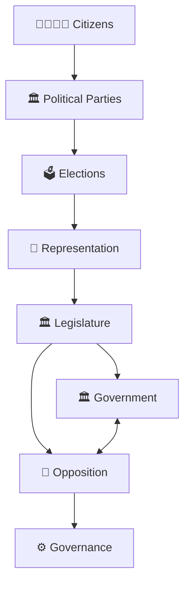
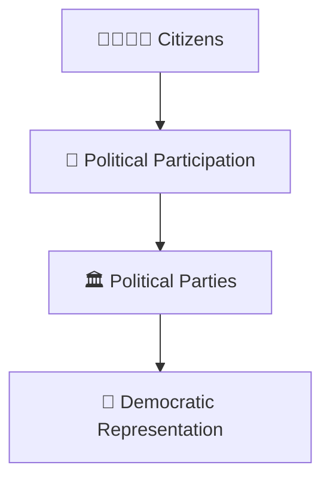
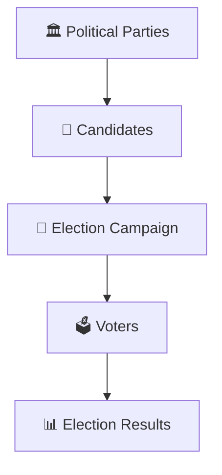
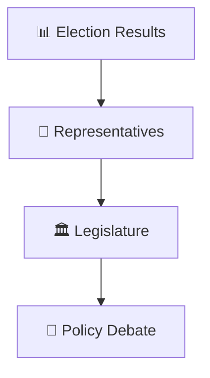
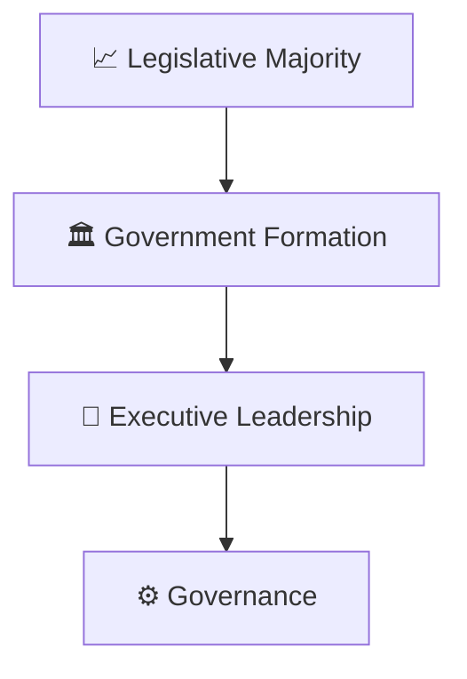
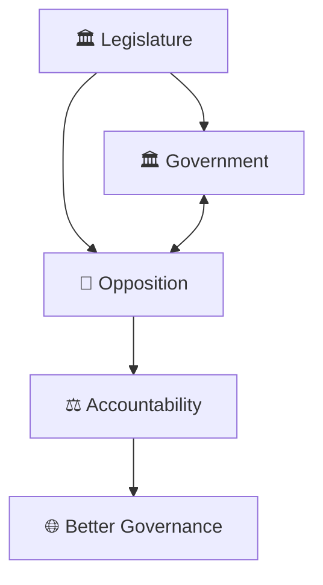
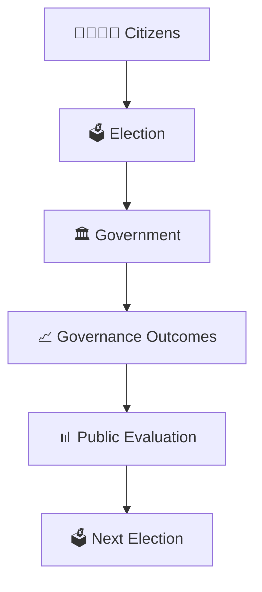
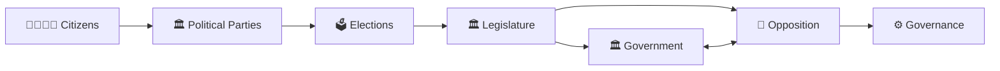

# Political Party Ecosystem

## Overview

This diagram explains how political parties function within India's democratic system and how they connect citizens, elections, representation, government formation, opposition, and governance.

It serves as the foundation diagram for understanding India's political party system.

---

## Why It Matters

Understanding the political party ecosystem helps explain:

- How democratic representation works
- How elections are organized
- How governments are formed
- How opposition functions
- How governance is influenced by political competition

---

---

## Political Party Ecosystem

---

## Citizen Participation Framework

### Purpose

- Represent public interests
- Aggregate public opinion
- Promote political participation

---

## Election Framework

### Outcome

- Citizens choose representatives.
- Legislative composition is determined.

---

## Representation Framework

### Purpose

- Connect citizens and institutions.
- Enable democratic decision-making.

---

## Government Formation Framework

---

## Government and Opposition Model

---

## Democratic Accountability Cycle

---

## Quick Revision

---

## Related Topics

- party-to-government-journey.md
- coalition-formation-model.md
- government-vs-opposition-framework.md
- national-vs-regional-parties.md
- election-process-flow.md
- political-terminology.md
