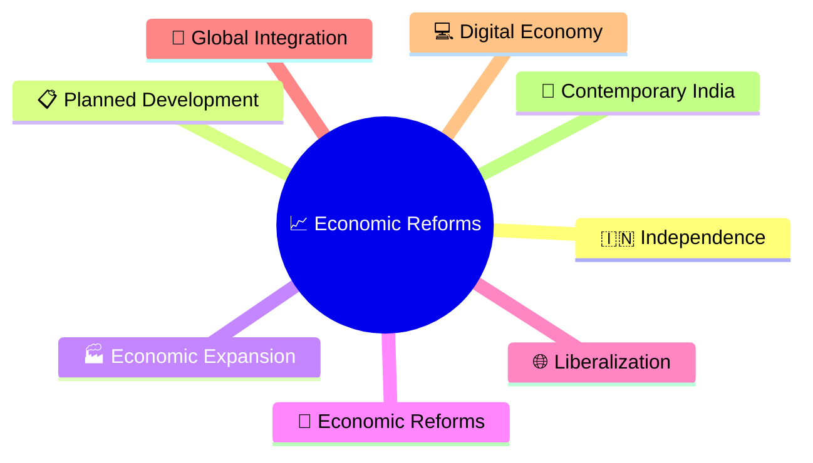
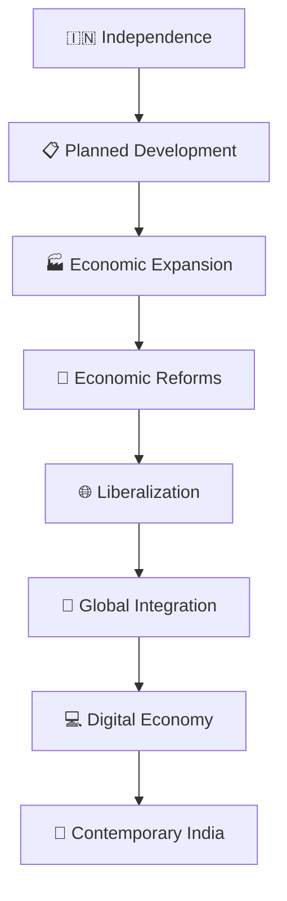
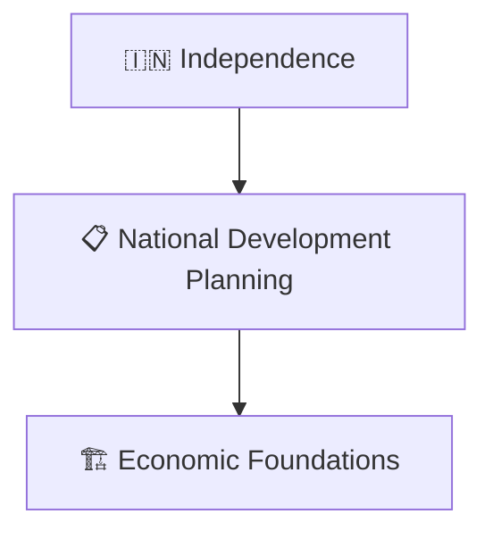
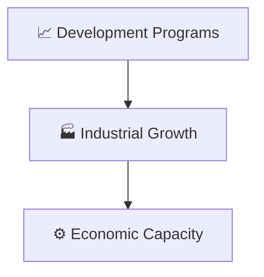
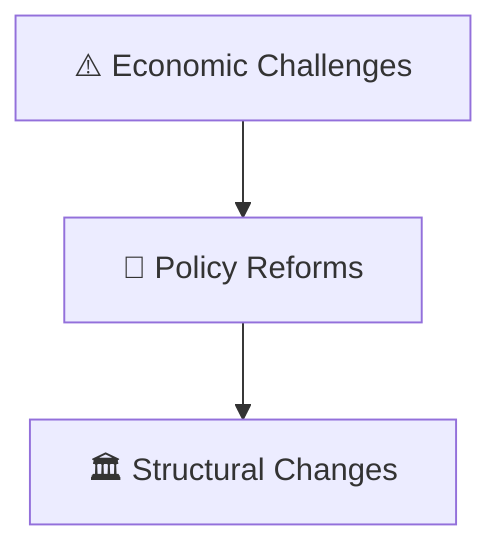
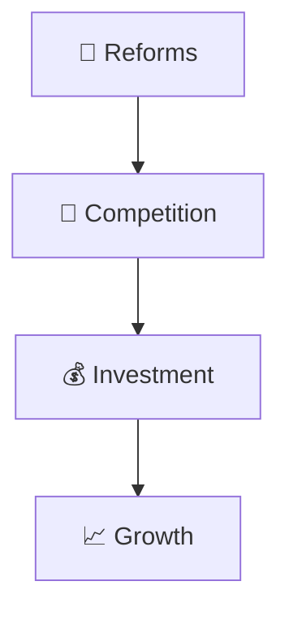
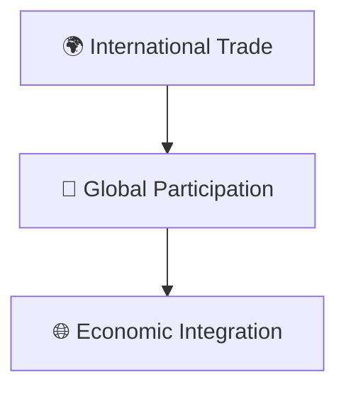
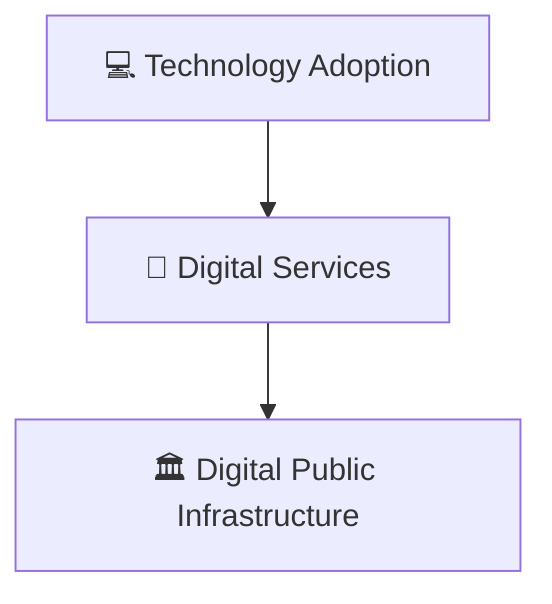
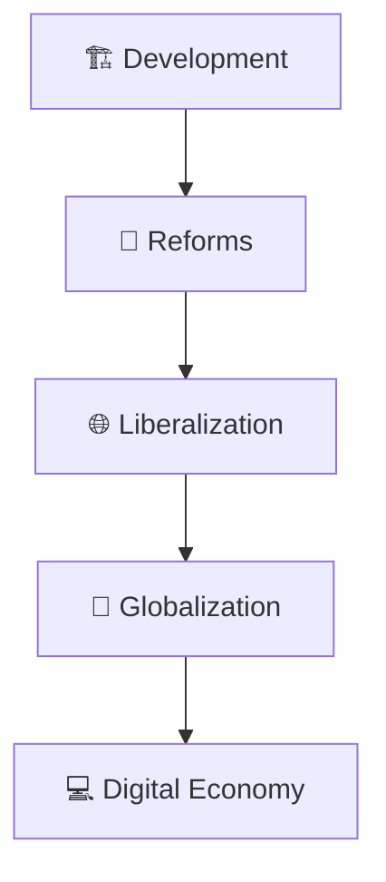

# Economic Reforms Timeline

## Overview

This timeline explains the major phases of India's economic development and reform journey from independence to contemporary India.

It provides a high-level view of how economic policy, development strategy, liberalization, globalization, and digital transformation shaped modern India.

---

## Why It Matters

Understanding economic reforms helps explain:

- How India's economy evolved
- How development strategies changed over time
- How reforms influenced growth
- How globalization affected India
- How contemporary economic systems emerged

---

---

## Economic Reforms Timeline

---

## Phase 1: Planned Development

### Significance

- Infrastructure creation
- Industrial development
- Agricultural growth

---

## Phase 2: Economic Expansion

### Significance

- Expansion of production
- Growth of public institutions

---

## Phase 3: Economic Reforms

### Significance

- Policy modernization
- Increased efficiency
- Economic restructuring

---

## Phase 4: Liberalization

### Significance

- Market-oriented reforms
- Greater economic openness
- Increased investment activity

---

## Phase 5: Global Integration

### Significance

- Stronger global connections
- Expanded economic opportunities

---

## Phase 6: Digital Economy

### Significance

- Digital transformation
- Financial inclusion
- Improved accessibility

---

## Economic Development Framework

---

## Quick Revision

---

## Related Topics

- nation-building-timeline.md
- constitutional-development-timeline.md
- economic-transformations.md
- contemporary-india.md
- governance-reforms.md
- economic-terminology.md
