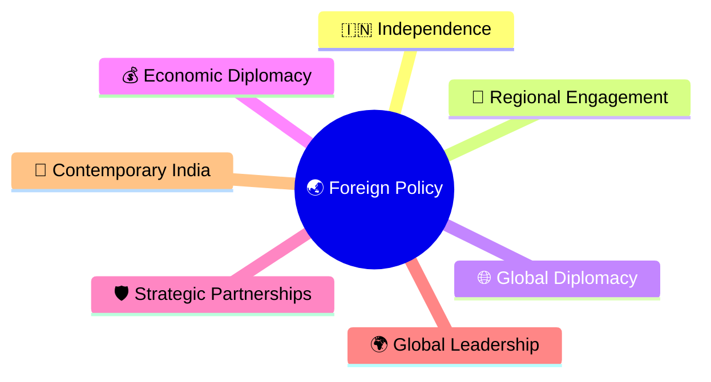
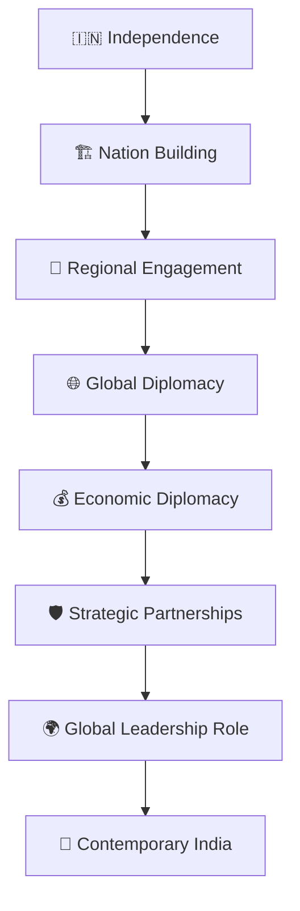
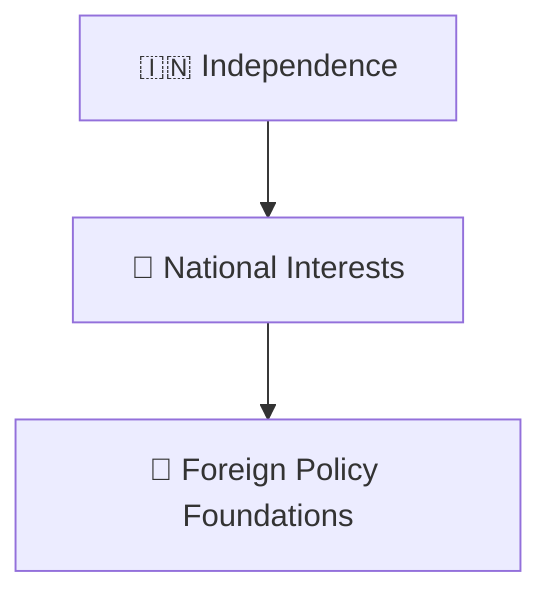
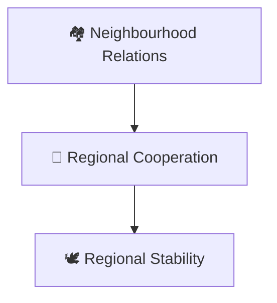
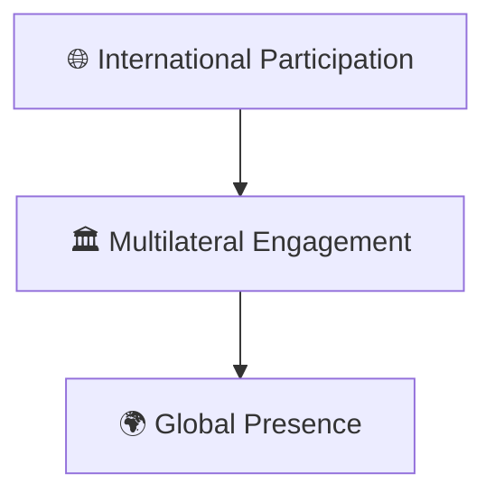
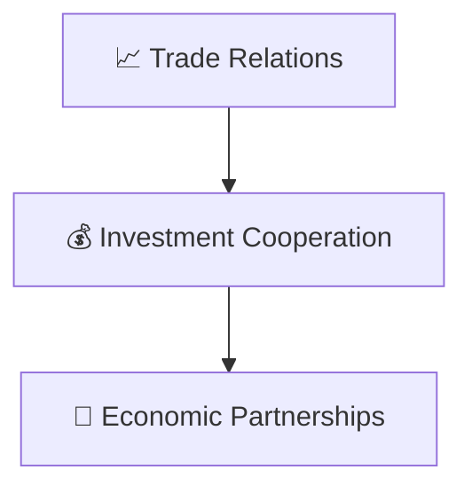
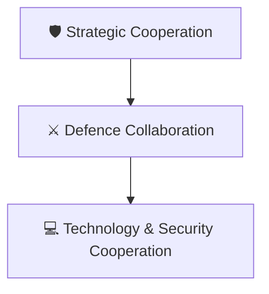
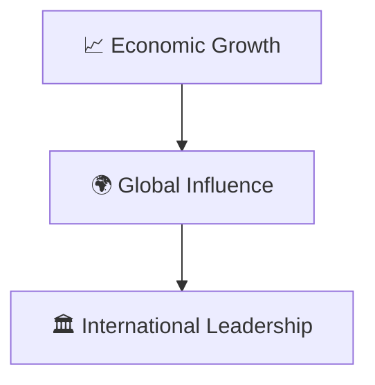
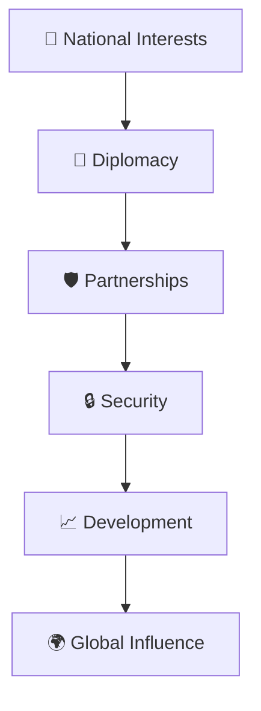

# Foreign Policy Timeline

## Overview

This timeline explains the evolution of India's foreign policy from independence to contemporary India.

It provides a high-level understanding of how India developed its international relations, strategic partnerships, regional engagement, economic diplomacy, and global role.

---

## Why It Matters

Understanding foreign policy helps explain:

- How India interacts with the world
- How strategic priorities evolved
- How economic diplomacy developed
- How security considerations shaped policy
- How India emerged as a major global actor

---

## Foreign Policy Timeline

---

## Phase 1: Independence & Foundations

### Significance

- Establishment of diplomatic relations
- Protection of national interests
- International recognition

---

## Phase 2: Regional Engagement

### Significance

- Focus on neighbouring countries
- Regional cooperation initiatives
- Stability and development goals

---

## Phase 3: Global Diplomacy

### Significance

- Participation in international institutions
- Expansion of diplomatic influence

---

## Phase 4: Economic Diplomacy

### Significance

- Economic growth support
- International trade expansion
- Investment opportunities

---

## Phase 5: Strategic Partnerships

### Significance

- Enhanced security cooperation
- Long-term partnerships
- Strategic balance

---

## Phase 6: Global Leadership Role

### Significance

- Expanded global role
- Greater international engagement
- Increased diplomatic influence

---

## Foreign Policy Framework

---

## Quick Revision

---

## Related Topics

- prime-ministers-timeline.md
- constitutional-development-timeline.md
- economic-reforms-timeline.md
- contemporary-india.md
- foreign-policy.md
- international-relations.md
