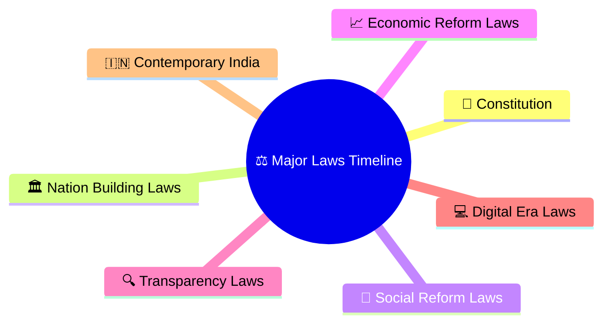
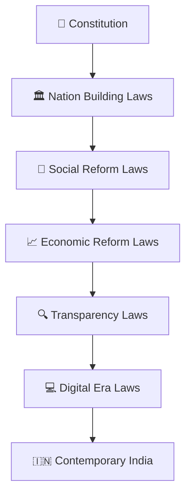
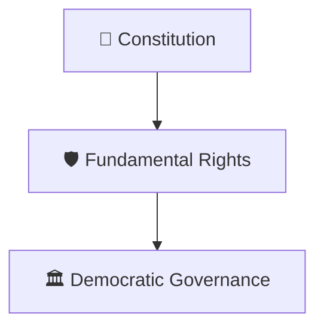
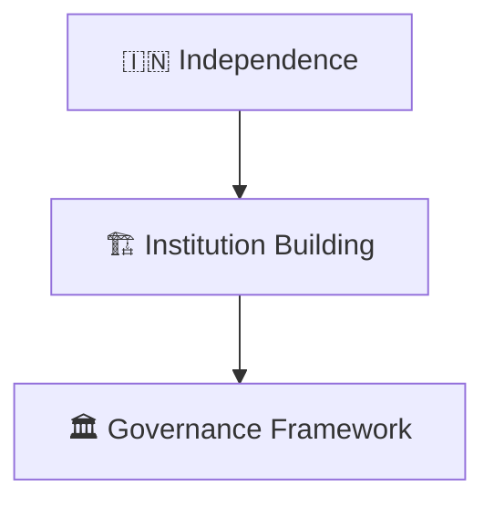
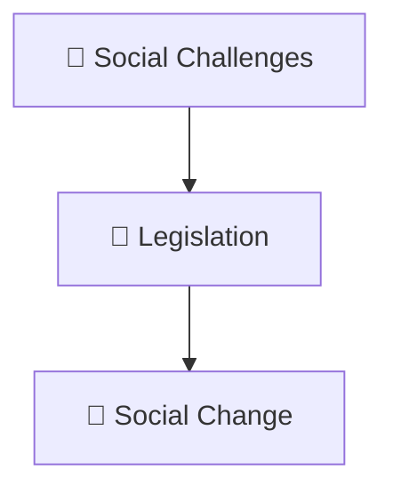
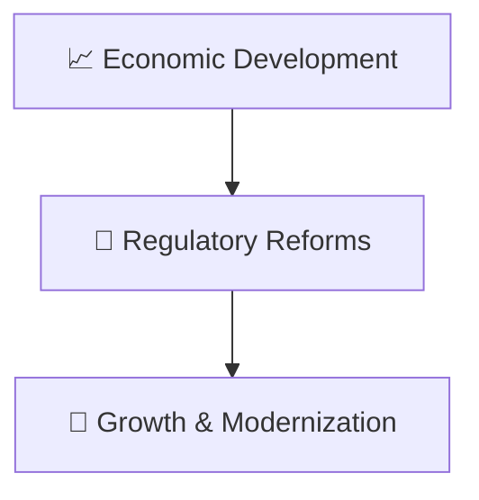
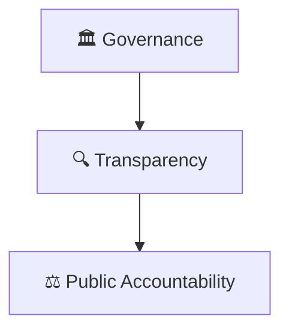
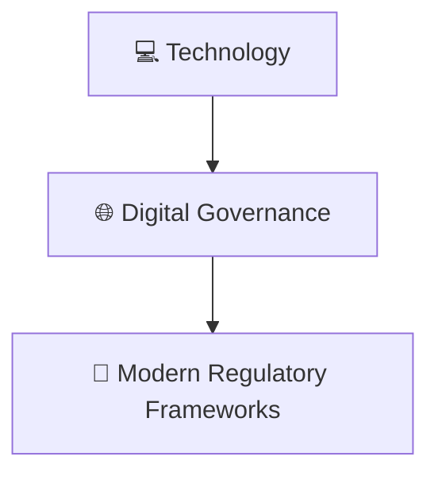
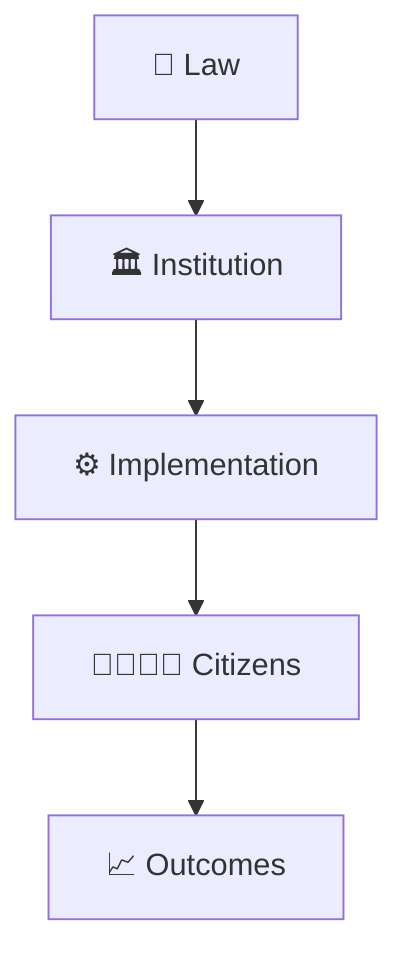

# Major Laws Timeline

## Overview

This timeline explains how major laws shaped modern India and influenced governance, rights, administration, economy, society, and public institutions.

It provides a high-level view of the evolution of India's legal and governance framework.

---

## Why It Matters

Understanding major laws helps explain:

- How citizens' rights evolved
- How governance changed over time
- How institutions gained powers and responsibilities
- How social and economic reforms were implemented
- How modern India developed through legislation

---

## Major Laws Timeline

---

## Phase 1: Constitutional Foundation

### Significance

- Rule of law
- Democratic institutions
- Citizen protections

---

## Phase 2: Nation Building Laws

### Significance

- Administrative stability
- Institutional development
- National integration

---

## Phase 3: Social Reform Laws

### Significance

- Greater equality
- Citizen protections
- Social development

---

## Phase 4: Economic Reform Laws

### Significance

- Economic expansion
- Market development
- Investment support

---

## Phase 5: Transparency & Accountability Laws

### Significance

- Better oversight
- Citizen participation
- Stronger institutions

---

## Phase 6: Digital Era Laws

### Significance

- Digital services
- Data-driven governance
- Technology regulation

---

## Law to Governance Framework

---

## Quick Revision

---

## Related Topics

- constitutional-development-timeline.md
- governance-reform-timeline.md
- economic-reforms-timeline.md
- parliament-and-law-making.md
- how-a-bill-becomes-law.md
- constitutional-governance-model.md
