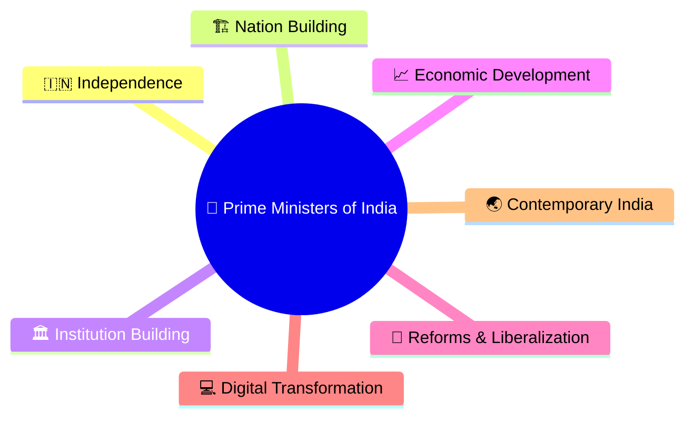
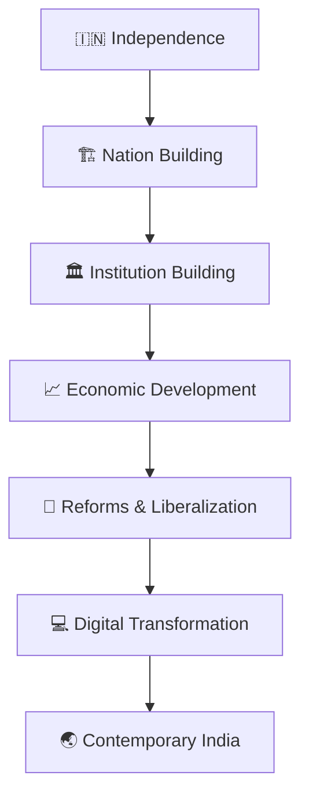
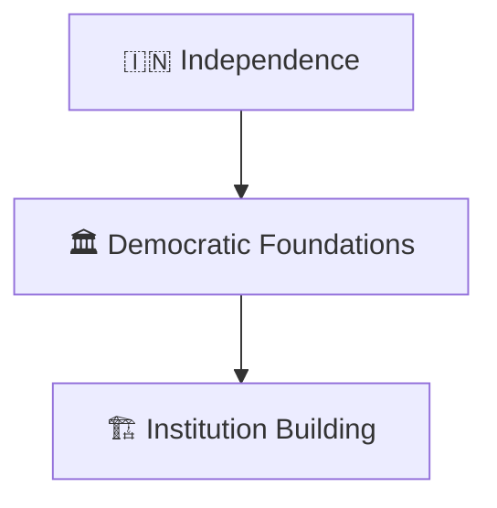
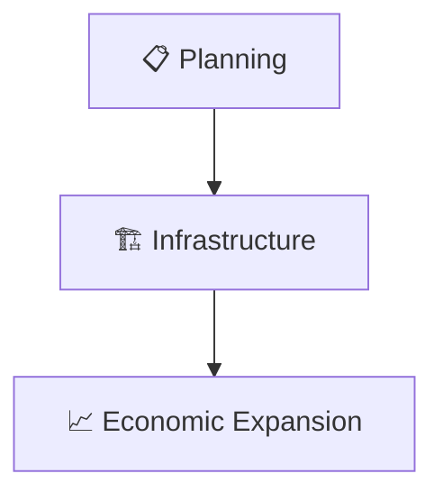
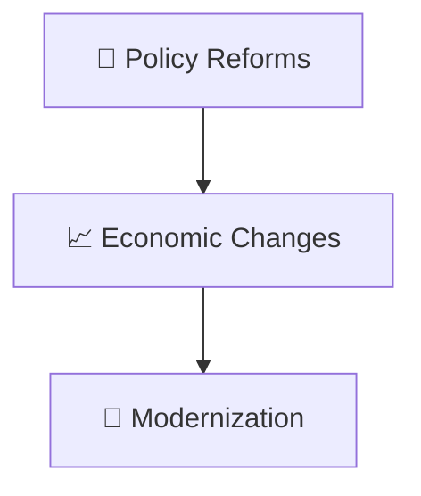
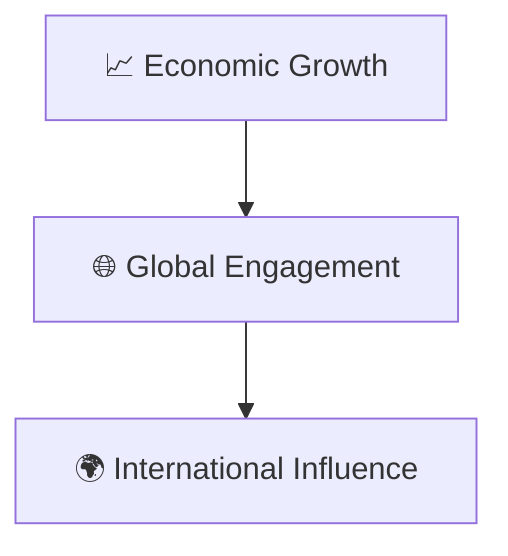
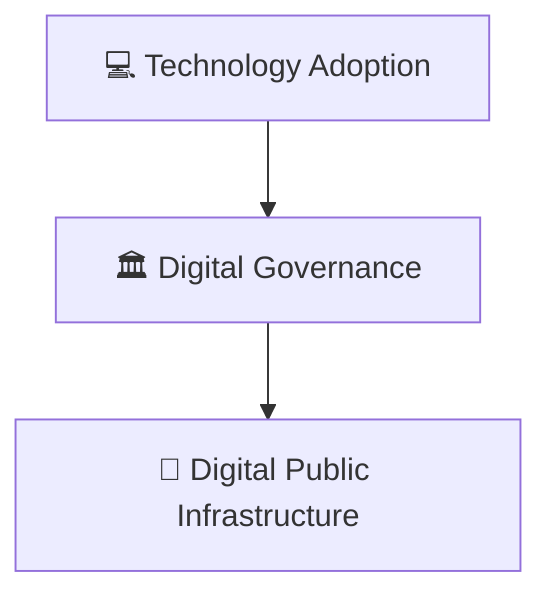
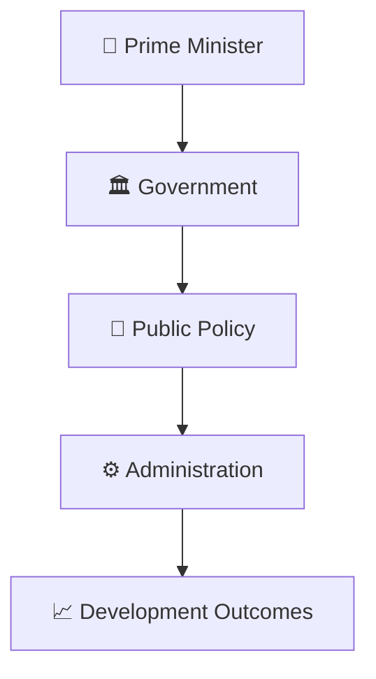
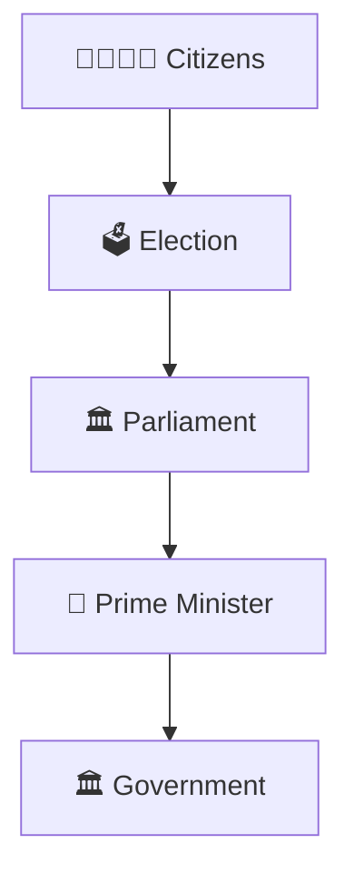

# Prime Ministers Timeline

## Overview

This timeline explains the evolution of the office of the Prime Minister of India and the major phases of governance, policy direction, economic development, and nation-building since independence.

It provides a high-level understanding of how leadership and governments shaped modern India.

---

## Why It Matters

Understanding the Prime Ministers timeline helps explain:

- Evolution of democratic governance
- Policy and reform journeys
- Economic transformation
- National development priorities
- Contemporary India's emergence

---

---

## Prime Ministers Timeline

---

## Phase 1: Nation Building

### Significance

- Establishment of democratic governance
- Development of national institutions
- Foundation of public administration

---

## Phase 2: Development Era

### Significance

- National development programs
- Industrial and agricultural growth
- Expansion of public institutions

---

## Phase 3: Reform Era

### Significance

- Structural reforms
- Economic modernization
- Governance improvements

---

## Phase 4: Global Integration

### Significance

- Greater international participation
- Expanded economic partnerships
- Stronger global presence

---

## Phase 5: Digital Transformation

### Significance

- Improved service delivery
- Administrative modernization
- Digital inclusion

---

## Governance Evolution Framework

---

## Prime Minister and Democracy

### Significance

- Democratic legitimacy
- Parliamentary accountability
- Representative governance

---

## Quick Revision

---

## Related Topics

- presidents-timeline.md
- constitutional-development-timeline.md
- economic-reforms-timeline.md
- foreign-policy-timeline.md
- prime-ministers-and-governments.md
- contemporary-india.md
