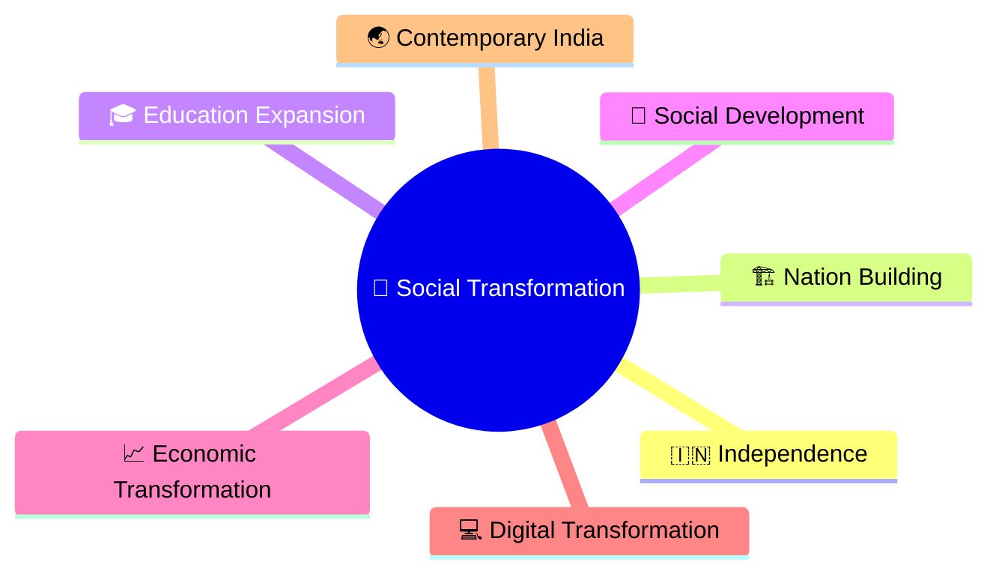
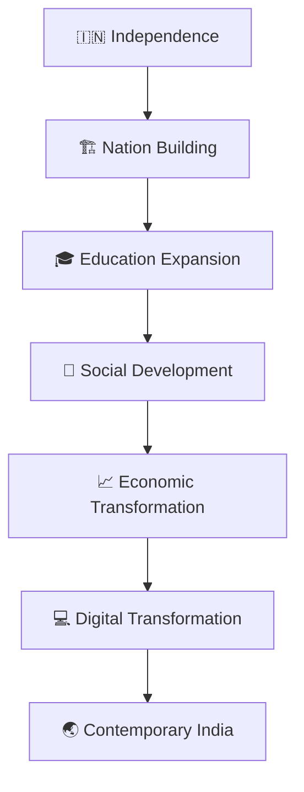
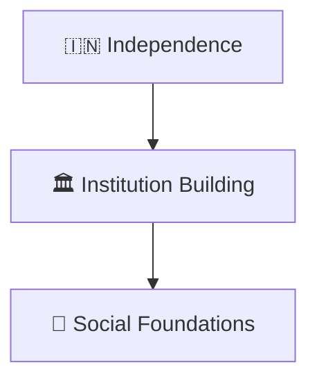
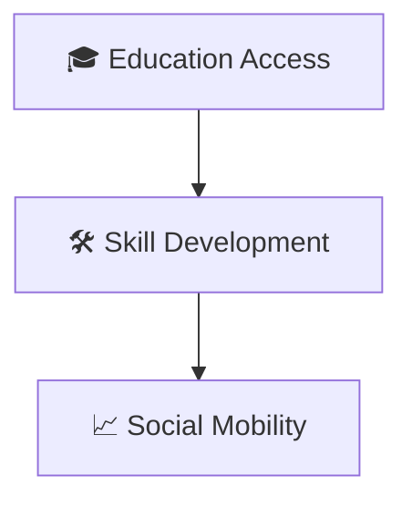
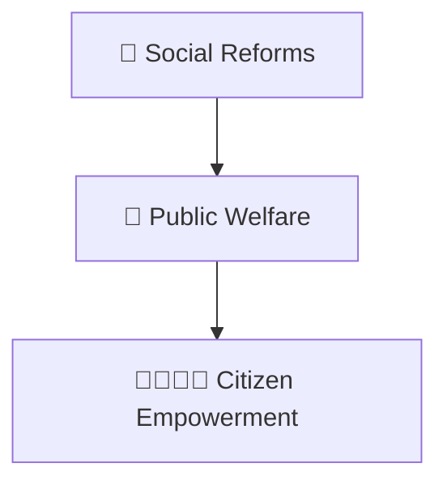
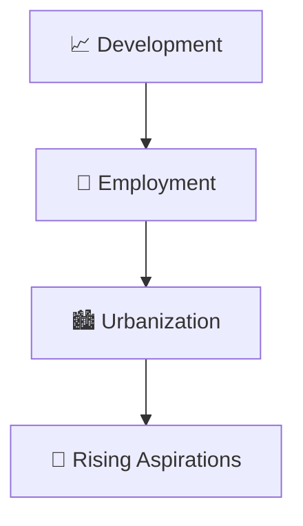
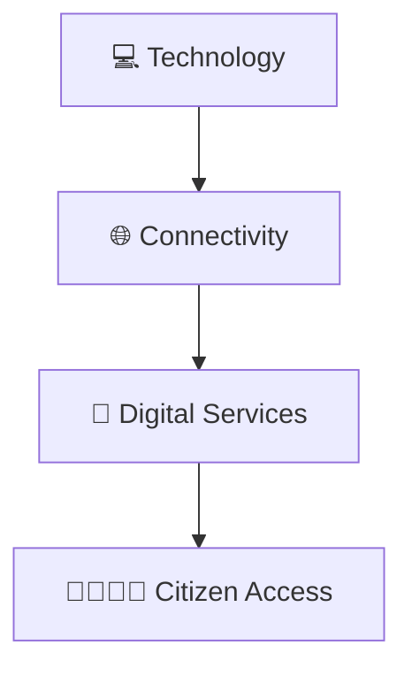
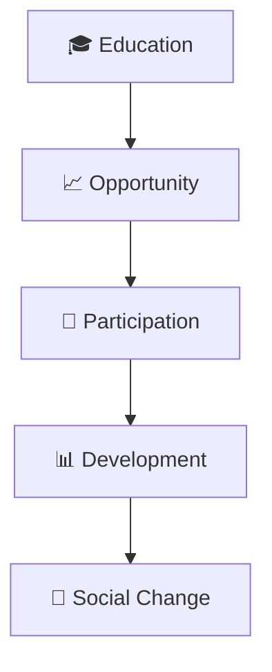

# Social Transformation Timeline

## Overview

This timeline explains the major phases of social transformation in India from independence to contemporary India.

It provides a high-level understanding of how education, social justice, urbanization, technology, economic development, and citizen participation influenced societal change.

---

## Why It Matters

Understanding social transformation helps explain:

- How Indian society evolved
- How opportunities expanded over time
- How social inclusion improved
- How technology changed everyday life
- How citizens participate in modern India

---

---

## Social Transformation Timeline

---

## Phase 1: Nation Building

### Significance

- Democratic participation
- Social integration
- National development

---

## Phase 2: Education Expansion

### Significance

- Greater literacy
- Expanded opportunities
- Human capital development

---

## Phase 3: Social Development

### Significance

- Improved inclusion
- Better access to services
- Stronger social participation

---

## Phase 4: Economic Transformation

### Significance

- Economic opportunities
- Changing lifestyles
- Growing middle class

---

## Phase 5: Digital Transformation

### Significance

- Information access
- Digital participation
- Improved service delivery

---

## Social Change Framework

---

## Quick Revision

---

## Related Topics

- nation-building-timeline.md
- economic-reforms-timeline.md
- governance-reform-timeline.md
- major-laws-timeline.md
- constitutional-development-timeline.md
- contemporary-india.md
