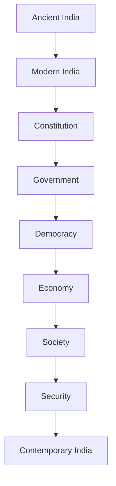
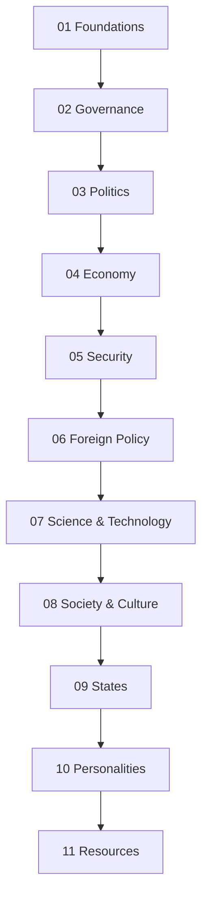
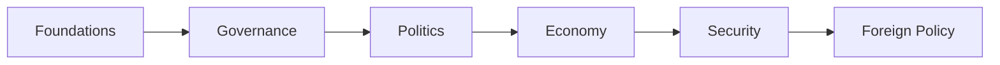
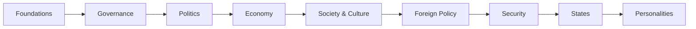

# 🇮🇳 India

> A structured knowledge repository for understanding India from ancient civilization to modern democracy.

## 🗺️ Repository Overview

> One repository. Eleven domains. Thousands of years of Indian history, governance, and nation-building.

India cannot be understood through a single subject.

History explains where India came from.  
The Constitution explains how the nation was built.  
Governance explains how the state functions.  
Politics explains how power is exercised.  
The economy, society, security, and foreign policy explain how India operates today.

This repository connects these topics into one learning journey.

---

# 🗂️ Repository Structure

---

## 🔗 Why This Repository?

Most resources explain individual topics.

This repository explains how they connect.

Instead of memorizing isolated facts, you learn how different parts of India evolved and became connected.

---

## 📚 What You'll Learn

- Indian civilization and history
- Constitution and governance
- Parliament and judiciary
- Elections and political parties
- Major laws and reforms
- Economy and development
- Society and culture
- Foreign policy and national security
- Science, technology, and space
- States and Union Territories
- Important leaders and institutions

---

## 🧭 Repository Journey

---

## 🏛️ Quick Domain Guide

| Domain | Focus Area |
|----------|----------|
| 01-foundations | History, Modern India, Geography |
| 02-governance | Constitution, Government, Parliament, Judiciary |
| 03-politics | Elections, Political Parties, Contemporary Politics |
| 04-economy | Economy, Development, Infrastructure |
| 05-security | Defence, Home Affairs, National Security |
| 06-foreign-policy | India's Relations with the World |
| 07-science-technology | Space, Nuclear, Science & Technology |
| 08-society-culture | Society, Heritage, Religion, Tourism |
| 09-states | States and Union Territories |
| 10-personalities | Important National and Regional Leaders |
| 11-resources | Glossary, Diagrams, Timelines, References |

---

## 🚀 Recommended Learning Path

### 🌱 New Learners

### 📰 Current Affairs Readers

### 🇮🇳 Complete India Journey

---

## 🎯 Why This Repository Exists

Understanding India requires more than following daily news.

This repository brings together history, governance, politics, economy, society, security, foreign policy, and national institutions to help citizens understand how India evolved and how the country functions today.

---

## 👥 Who Is This Repository For?

- Anyone interested in understanding India
- Students
- UPSC & State PSC aspirants
- Professionals
- Researchers
- Curious citizens

No prior knowledge is required.