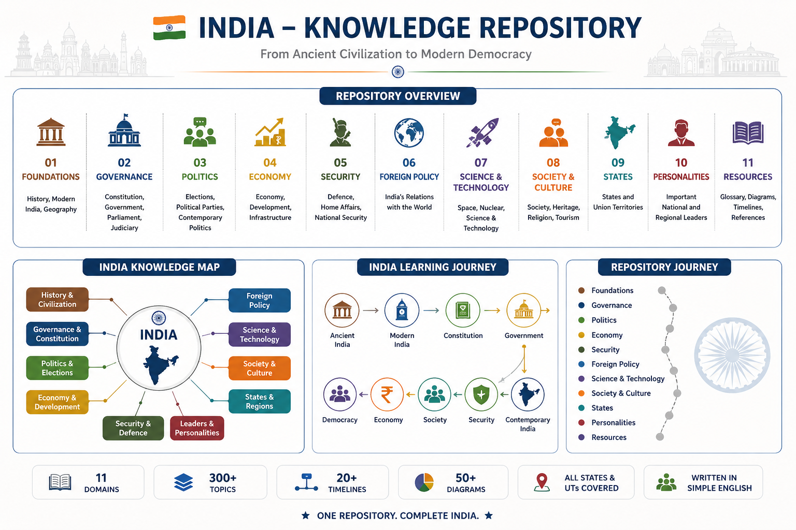
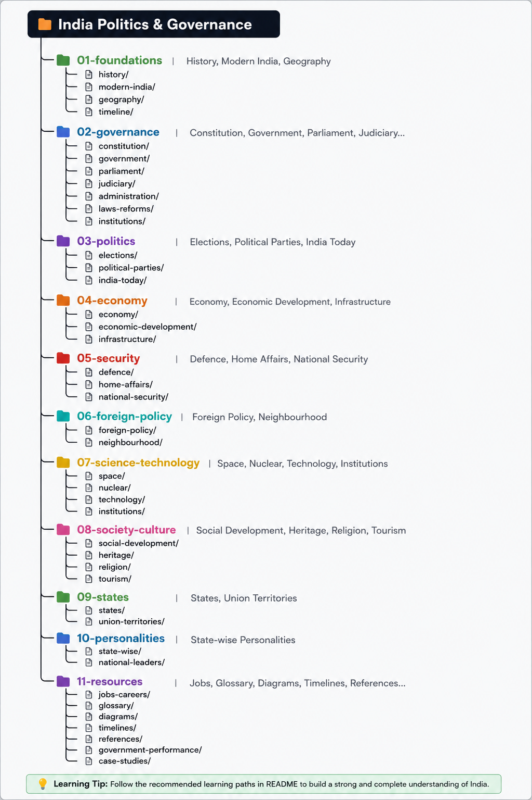
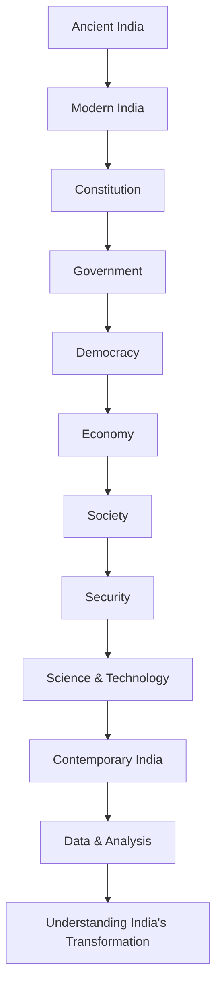

# 🇮🇳 India


> A structured knowledge repository for understanding India from ancient civilization to modern democracy.

## 📑 Table of Contents

* [🗺️ Repository Overview](#️-repository-overview)
* [🗂️ Repository Dashboard](#️-repository-dashboard)

  * [🧭 India Knowledge Dashboard](#-india-knowledge-dashboard)
* [📊 Data & Analysis](#-data--analysis)
* [⭐ Current Focus](#-current-focus)

  * [🔬 Science & Technology → Nuclear Energy](#-science--technology--nuclear-energy)
* [🔗 Why This Repository?](#-why-this-repository)
* [🧩 Repository Architecture](#-repository-architecture)

  * [Knowledge Domains](#knowledge-domains)
  * [Supporting Layers](#supporting-layers)
* [🎯 Long-Term Vision](#-long-term-vision)
* [📌 Primary Focus](#-primary-focus)
* [📈 India Through Data](#-india-through-data)
* [🧭 Learning Journey](#-learning-journey)

---

## 🗺️ Repository Overview



> One repository. Eleven knowledge domains, supported by dedicated resource, data, and analysis layers — covering thousands of years of Indian history, governance, and nation-building.

India cannot be understood through a single subject.

History explains where India came from.

The Constitution explains how the nation was built.

Governance explains how the state functions.

Politics explains how power is exercised.

The economy, society, security, foreign policy, and science and technology explain how India operates today.

This repository connects these topics into one learning journey.

---

# 🗂️ Repository Dashboard



## 🧭 India Knowledge Dashboard

| #      | Domain                      | Major Areas                                                            | Access                                    |
| ------ | --------------------------- | ---------------------------------------------------------------------- | ----------------------------------------- |
| **01** | 🏛️ **Foundations**         | History · Modern India · Geography                                     | [Open →](01-foundations/README.md)        |
| **02** | ⚖️ **Governance**           | Constitution · Government · Parliament · Judiciary                     | [Open →](02-governance/README.md)         |
| **03** | 🗳️ **Politics**            | Elections · Political Parties · Contemporary Politics                  | [Open →](03-politics/README.md)           |
| **04** | 💰 **Economy**              | Economy · Development · Infrastructure                                 | [Open →](04-economy/README.md)            |
| **05** | 🛡️ **Security**            | Defence · Home Affairs · National Security                             | [Open →](05-security/README.md)           |
| **06** | 🌍 **Foreign Policy**       | Neighbours · Strategic Partners · Regional Organizations · Geopolitics | [Open →](06-foreign-policy/README.md)     |
| **07** | 🔬 **Science & Technology** | Space · Nuclear Energy · Science & Technology                          | [Open →](07-science-technology/README.md) |
| **08** | 🎭 **Society & Culture**    | Society · Heritage · Religion · Tourism                                | [Open →](08-society-culture/README.md)    |
| **09** | 🗺️ **States**              | States · Union Territories · Regional Profiles                         | [Open →](09-states/README.md)             |
| **10** | 👤 **Personalities**        | National · Regional · Political · Cultural · Business Leaders          | [Open →](10-personalities/README.md)      |
| **11** | 📚 **Resources**            | Glossary · Diagrams · Timelines · References                           | [Open →](11-resources/README.md)          |

---

## 📊 Data & Analysis

The repository also maintains dedicated layers for collecting, organizing, and analyzing India's data.

| Area           | Data                              | Analysis                                  |
| -------------- | --------------------------------- | ----------------------------------------- |
| Population     | [Data →](12-data/population/)     | [Analysis →](13-analysis/population/)     |
| Demographics   | [Data →](12-data/demographics/)   | [Analysis →](13-analysis/demographics/)   |
| Economy        | [Data →](12-data/economy/)        | [Analysis →](13-analysis/economy/)        |
| Employment     | [Data →](12-data/employment/)     | [Analysis →](13-analysis/employment/)     |
| Health         | [Data →](12-data/health/)         | [Analysis →](13-analysis/health/)         |
| Education      | [Data →](12-data/education/)      | [Analysis →](13-analysis/education/)      |
| Poverty        | [Data →](12-data/poverty/)        | [Analysis →](13-analysis/poverty/)        |
| Agriculture    | [Data →](12-data/agriculture/)    | [Analysis →](13-analysis/agriculture/)    |
| Industry       | [Data →](12-data/industry/)       | [Analysis →](13-analysis/industry/)       |
| Infrastructure | [Data →](12-data/infrastructure/) | [Analysis →](13-analysis/infrastructure/) |
| Environment    | [Data →](12-data/environment/)    | [Analysis →](13-analysis/environment/)    |
| Governance     | [Data →](12-data/governance/)     | [Analysis →](13-analysis/governance/)     |

> **Resources → Data → Analysis**
>
> Reliable sources are identified first, relevant data is collected and organized, and analysis is then built from that data.

---

## ⭐ Current Focus

### 🔬 Science & Technology → Nuclear Energy

The current expansion focuses on India's nuclear-energy programme.

**[Open Indian Nuclear Energy →](07-science-technology/nuclear-energy/README.md)**

| Area                           | Coverage                                                     |
| ------------------------------ | ------------------------------------------------------------ |
| **01 History**                 | Origins of India's Nuclear Programme · Homi Bhabha · Trombay |
| **02 Three-Stage Programme**   | PHWR · Plutonium · Fast Breeders · Thorium · U-233           |
| **03 Nuclear Resources**       | Uranium · Thorium · Monazite · Resource Strategy             |
| **04 Nuclear Reactors**        | PHWR · FBR · PFBR · Kalpakkam · Future Reactors              |
| **05 Thorium Programme**       | Thorium Strategy · U-233 · AHWR · Future Thorium             |
| **06 Nuclear Fuel Cycle**      | Fuel Cycle · Reprocessing · Plutonium · U-233 · Closed Cycle |
| **07 Nuclear Strategy**        | Pokhran 1974 · Pokhran 1998 · Nuclear Doctrine               |
| **08 Sanctions & Geopolitics** | Technology Denial · NSG · India-US Deal · Nuclear Diplomacy  |
| **09 Nuclear Energy Policy**   | Policy · Targets · Energy Security · Climate · Future        |
| **10 Nuclear Organizations**   | DAE · AEC · BARC · NPCIL · BHAVINI · IGCAR · Others          |

---

## 🔗 Why This Repository?

Most resources explain individual topics.

This repository explains how they connect.



---

## 🧩 Repository Architecture

The repository is organized into **eleven knowledge domains** supported by dedicated resource, data, and analysis layers.

```text
01-foundations/
02-governance/
03-politics/
04-economy/
05-security/
06-foreign-policy/
07-science-technology/
08-society-culture/
09-states/
10-personalities/
11-resources/
12-data/
13-analysis/
```

### Knowledge Domains

```text
01–10 → Core knowledge domains
```

These contain the substantive knowledge about India.

### Supporting Layers

```text
11 → Resources
12 → Data
13 → Analysis
```

These support research, learning, data collection, and analytical work across the core domains.

---

## 🎯 Long-Term Vision

Build a comprehensive, structured, and easy-to-understand knowledge system explaining India's evolution:

```text
Ancient Civilization
        ↓
Kingdoms & Empires
        ↓
Colonial India
        ↓
Freedom Struggle
        ↓
Independent India
        ↓
Republic of India
        ↓
Economic Reforms
        ↓
Digital India
        ↓
Contemporary India
        ↓
Future India
```

The repository connects:

* History
* Geography
* Constitution
* Governance
* Politics
* Economy
* Society & Culture
* National Security
* Foreign Policy
* Science & Technology
* States & Union Territories
* Personalities
* Data & Statistics
* Public Policy
* Institutions
* Laws & Reforms
* Elections
* Development

into a unified learning and knowledge system.

---

## 📌 Primary Focus

1. 🇮🇳 **India**
2. 🟢 **West Bengal**
3. 🗺️ **Remaining States & Union Territories**

---

## 📈 India Through Data

A long-term effort to understand India's transformation through reliable data and analysis.

```text
Reliable Sources
       ↓
Data Collection
       ↓
Data Organization
       ↓
Analysis
       ↓
Comparisons & Trends
       ↓
Evidence-Based Understanding
```

The project will prioritize **Indian official sources** wherever appropriate and use independent international sources for validation and cross-checking.

---

## 🧭 Learning Journey

```text
Foundations
     ↓
Governance
     ↓
Politics
     ↓
Economy
     ↓
Security
     ↓
Foreign Policy
     ↓
Science & Technology
     ↓
Society & Culture
     ↓
States
     ↓
Personalities
     ↓
Resources
     ↓
Data
     ↓
Analysis
     ↓
Understanding India
```
